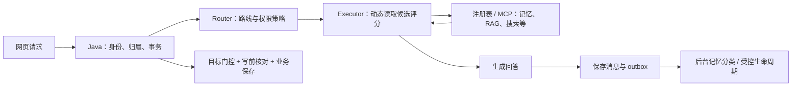

当前面试版请从[单 Executor 的流程、运行和评测](README.md)开始。以下内容是多模型冻结版本的历史交接。

# Attune 项目交接入口

整理日期：2026-10-21。源码基线为 `freeze-20261020-attune`，提交 `48cfcb982f3c20f1565d1dec2af8d2897ab3dc39`，开发分支 `feat/jev-memory-lifecycle`。本入口是冻结后的文档补充，不移动冻结标签。它描述源码与已记录的验收，不代表此刻服务器在线状态；接手运行环境时仍须核对实际配置、健康信息和权重 SHA。

## 从这里开始

| 接手任务 | 首先打开 | 看完应能回答 |
| --- | --- | --- |
| 理解项目是什么 | [根 README](README.md) | 谁做判断、谁生成回答、数据保存在哪里？ |
| 接手模型训练 | **[模型训练交接](docs/model-training-handoff.md)** | 当前用哪些权重；数据、训练、评测、服务分别从哪里进入？ |
| 理解应用架构 | [当前架构](docs/architecture.md) | 一条消息怎样经过权限路由、loop、工具、生成与持久化？ |
| 按源码学习 | [15 天学习路线](docs/source-learning-roadmap.md) | 今天读哪些函数、追踪哪个样例、对应哪些测试？ |
| 恢复冻结版本 | [冻结说明](docs/freeze-20261020.md) | 标签、两个模型 Release、验收范围和已知限制是什么？ |
| 启动应用 | [部署说明](docs/deployment.md) + [.env.example](.env.example) | Java、Runtime、数据库和模型 worker 怎样连接？ |

## 项目的一句话说明

Attune 是具有跨会话记忆、心理知识检索与目标推进能力的对话 Agent。采用原生网页、Spring Boot 和 Python / LangGraph 有界 loop；本地小模型负责有限候选判断，生成模型负责自然语言回答和计划。这里的 JEV 是设计思路，不是官方 JEV API，也没有完整复现 JEV-Mem。

图中的箭头表示主要职责关系；实际节点与故障路径见架构页。模型给出判断，宿主仍控制权限、参数、预算和写入。

## 当前模型，避免与历史方案混淆

| 职责 | 冻结版本的实现 |
| --- | --- |
| Router | Qwen 4B LoRA |
| 工具 Executor | ToolACE Qwen 4B；Laya v6 是故障回退 |
| 基础 Memory | Qwen 4B：分类、相关性、证据充分性 |
| 长期事实生命周期 | 独立 Qwen 4B LoRA v2，显式账号范围启用 |
| 目标门控 | 独立 Qwen 4B + 生成模型写前核对 + 后端业务校验 |
| 旧目标判断 | Qwen 4B，保留兼容路径 |
| 记忆 / 知识重排 | 原版 Qwen3-Reranker-0.6B，未微调，任务指令独立 |
| 回答与规划 | DeepSeek / Ollama / 用户配置的兼容生成 API |

“三个决策角色”是职责划分，不等于只部署三个进程。当前权重、契约和恢复方法统一见[模型训练交接](docs/model-training-handoff.md)。

## 接手代码的最短路径

1. **训练线**：`agent-runtime/training/public_tools/` → `psych_agent_runtime/public_tool_contract.py` → `psych_agent_runtime/public_tool_service.py`。先理解一个动态工具选择模型的完整生命周期，再读 Router、Memory 和目标门控的差异。
2. **应用线**：`backend/.../AgentGatewayService.java` → `agent-runtime/psych_agent_runtime/api.py` → `graph.py` → `tool_controller.py` → `capabilities.py` → `response.py`。
3. **数据线**：`ConversationMemoryService.java` / `GoalService.java` → `memory.py` / `memory_projection.py` / `rag.py`。个人原话、公共知识、目标记录是不同事实源，不能混为一个向量库。

## 交接验收与未完成项

- 冻结时：Python 999 项通过；Java 99 项、0 失败、0 错误、1 跳过；前端 5 个测试文件通过。详细范围见[冻结说明](docs/freeze-20261020.md)，这些是历史验收记录，不是新机器的测试结果。
- 工具模型公开 test 示范一致率为 93.36%，不是项目端到端成功率；分数没有做项目概率校准。
- 目标完成、部分进度与反馈调整有开发联调记录；仍需持续收集自然表达下的漏调用和误写。
- 长期事实账本按账号控制，不能把“代码存在”解释成“全部账号已启用”。
- 搜索延迟、动态工具长句泛化、记忆证据覆盖、同会话并发排序和中断恢复仍需改进。历史 50 账号试用不能解释为 50 路同时推理能力。
- 混合 GPU 模型的完整 Compose 部署未重新验收；模型下载成功、HTTP 200、`health.ready=true`、完整业务跑通是不同验收层次。

## 当前学习衔接

本会话已讲解 `public_tools/fetch.py`，并串讲 `convert.py` 的工具目录、事件转换、原文保留、异常审计与监督边界；尚未据此认定已完全掌握。下一节从 `public_tools/course.py` 的 `decisions()` 开始，追踪“整段对话 → 多个下一动作样本 → 分组切分”。每次按一个完整功能讲解，结合输入输出、源码、样例、设计取舍与现有测试。

## 给后续协作者的工作约定

- 先读取本页和模型训练交接，区分当前主线、回退及历史失败实验；不从带日期报告中的“当前”推断今日配置。
- GPU 数据、缓存、日志、临时文件和检查点写在 lab 的 data 盘。既有服务器根目录为 `/home/ubuntu/data/psych-agent-routing-20261009`；原始产物路径在训练交接中列出，存在性需接手时核实。
- 密钥由私有配置或环境变量提供，不放入文档、训练数据或 Git。仓库为私有仓库，模型 Release 下载需要有权限的 GitHub 登录。
- 本轮交接只整理文档，不启动训练、不替换模型、不修改服务器进程。下一轮训练使用新输出目录；重载核对、项目回归和显式接入分开进行。
- 历史训练报告、manifest、权重 SHA 和冻结标签保持原值；新源码不冒充训练时逐字相同的源码。

## 2026-11-08 学习版更新

当前源码位于 `refactor/study-core-20261108`；冻结标签仍指向原版本。应用主链路去除缺失依赖回退、MCP 统一结果解码、训练参数默认值统一在命令行定义。

- [清理范围与源码完整性](docs/code-cleanup-20261108.md)
- [可复制的简历表述与指标来源](docs/resume.md)
- [最近一次权重编辑负结果](docs/weight-space-edit-round-20261106.md)

研究实验位于训练目录的“独立研究实验”导航；学习现用训练时先读 ToolACE、Memory、Router/Goal 的正式入口。源码依赖检查可执行 `python scripts/audit-source-coverage.py`。
