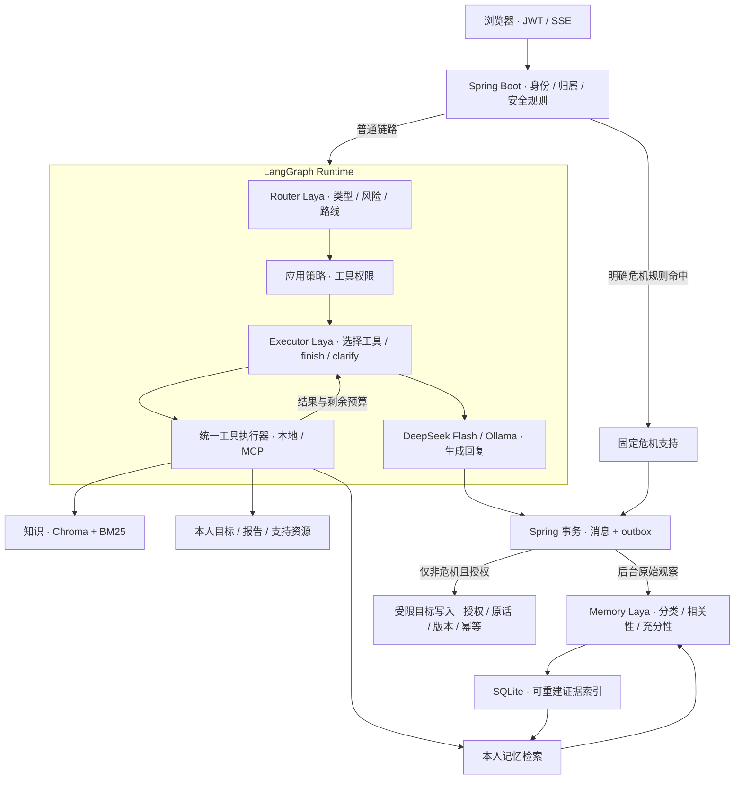

# Psych Agent

一个以 **Jev 风格决策层与三个独立 Laya 模型**为核心的心理支持 Agent。系统先判断对话类型、风险与工具权限，再选择权限内的工具；记忆由独立模型处理，回复与目标规划交给生成模型。

前端提供对话、目标小步骤、行动反馈、每周回顾、跨对话心理概要和运行记录。后端把身份、证据、版本、事务与写入权限留在应用层，让模型选择始终有明确边界。

> 项目用于支持性对话与 Agent 工程研究，不替代心理咨询、医学诊断或紧急服务。当前采用开源 Laya 的本地实现；记忆设计受 Jev-Mem 启发，尚未完整复现其四视图图检索。

## 项目亮点

- **三个独立决策角色**：Router 决定支持路线，Executor 选择授权工具，Memory 整理与筛选用户证据。各自训练、校准、部署和回滚。
- **有权限和预算的工具循环**：Executor 读取工具结果后再选择继续、结束或澄清，每轮最多两次只读工具调用；目标写入另走受限节点。
- **可持续推进的目标**：Agent 按明确命令创建目标与有序小步骤；聊天可识别实际进展，用户可以关闭自动同步或撤销。
- **基于事实的行动反思**：完成步骤后，结合已完成行动、感受和最新聊天看法生成下一步，依据完成标准判断目标状态。“做了一点”保存部分进展并反馈，不计为完成。
- **能追溯原话的个人回顾**：汇总多段对话，展示主题、情绪表达分布与时间变化；每周目标回顾使用真实行动记录。
- **真实运行可见**：SSE 展示处理过程，运行页面显示当前模型、工具、延迟、保存状态与降级记录。

## 架构



**生成与决策分开。** Laya 根据固定候选项及概率执行结构化判断，不承担最终对话生成。身份、会话、工具参数和候选行动由应用提供；模型不能自行扩大权限。

| 角色 | 当前开发权重 | 契约 | 职责 |
| --- | --- | --- | --- |
| Router | `psych-router-domain-v5` | `psych-router-v2` | 每轮判断对话类型、路线、风险与支持需要 |
| Executor | `psych-executor-domain-v6` | `psych-executor-v2` | 授权工具选择，以及目标创建、行动匹配、进度类型判断 |
| Memory | `psych-memory-domain-v8` | `psych-memory-v4` | 后台记忆分类、逐条证据相关性与证据充分性判断 |

三个角色均有独立权重，Runtime 通过 HTTP 调用 worker。当前 lab 部署的 Router 使用 CPU，Executor、Memory 使用 GPU；生成使用 DeepSeek Flash，本地 Ollama 继续提供 embedding。也可将生成切换到 Ollama。

## 工具与业务边界

| 能力 | 用途 | 执行方式 |
| --- | --- | --- |
| `search_knowledge` | 混合检索知识与引用来源 | Executor 在权限内选择 |
| `get_goal_context` | 读取本人目标、步骤与反馈 | Executor 在权限内选择 |
| `memory_search` | 查找本人既往表达，返回证据 | Executor 选择，Memory 筛选 |
| `get_dashboard` | 读取本人跨对话概要与报告 | Executor 在权限内选择 |
| `get_support_resources` | 读取已配置的求助资源 | 专业支持路径必需；明确资源请求也开放 |
| `create_goal` | 根据本轮明确命令生成并保存目标 | 消息保存后的受限写入节点 |
| `sync_goal_progress` | 将本人实际行动同步到已有步骤 | 消息保存后的受限写入节点 |

安全扫描、用户上下文、危机支持与对话保存属于固定系统节点。规则命中的风险不能被模型降级；危机路径绕过普通工具与目标写入。工具异常、低置信度或无效输出会显式记录，不伪造执行成功。

目标创建要求明确授权；进度同步校验拥有者、原话、版本和重复请求，并排除第三方、假设与未来计划。目标反思先保存行动事实，再调用生成模型；模型故障不会撤回已保存的进展。

原始消息与记忆 outbox 同事务保存。后台记忆区分用户观察与助手建议，避免把助手的话当成用户经历。Memory 当前使用有界 BM25/近期候选召回与最多两轮证据筛选；完整语义、时间、因果、实体四视图图检索尚未实现。

## 快速启动

### Docker Compose

需要 Docker 与 Docker Compose。基础配置默认使用规则决策和 Ollama 生成，不包含已训练领域权重。

```bash
git clone git@github.com:Vaniloo/psych-agent-engineering.git
cd psych-agent-engineering
git checkout feat/local-decision-router
cp .env.example .env
```

编辑 `.env`，设置独立的 `JWT_SECRET`、`INTERNAL_SERVICE_TOKEN` 和数据库密码，再启动：

```bash
docker compose up --build
```

| 服务 | 默认入口 |
| --- | --- |
| 前端 | `http://localhost` |
| Spring Boot | `http://localhost:8080` |
| Agent Runtime / 模型 worker | Compose 内部网络 |

首次启动会拉取 Ollama 聊天与 embedding 模型。需要准备对应磁盘与内存。使用 DeepSeek 生成时，在服务端 `.env` 配置：

```dotenv
AI_PROVIDER=deepseek
DEEPSEEK_API_KEY=<your-server-side-key>
DEEPSEEK_MODEL=deepseek-flash
MODEL_COST_MODE=remote
```

Java 的目标拆解、心理概要和行动反思，以及 Python 的回复生成，使用同一生成提供方。embedding 仍在本地执行。密钥不传给前端，也不进入 Git；费用估算需要另外配置输入/输出单价。

### 接入三个 Laya worker

训练器默认从 `convaiinnovations/laya-multilingual` 基础权重微调。**领域检查点当前保存在 lab 数据盘，尚未随仓库发布**；仅克隆代码不能直接加载本项目的三个领域模型。

有兼容检查点后，可分别启动：

```bash
DECISION_CHECKPOINT=/absolute/path/to/router DECISION_API_KEY=replace-router-key ./scripts/start-laya.sh router
DECISION_CHECKPOINT=/absolute/path/to/executor DECISION_API_KEY=replace-executor-key ./scripts/start-laya.sh executor
DECISION_CHECKPOINT=/absolute/path/to/memory DECISION_API_KEY=replace-memory-key ./scripts/start-laya.sh memory
```

以上命令中的路径与 key 为占位值，需替换后执行。启动脚本使用 `uv` 并安装 `routing` extra。Runtime 配置三个 `*_PROVIDER=laya`、对应 `*_BASE_URL` 和独立 `*_API_KEY`。使用 Memory v8 时设置 `MEMORY_CONTRACT_VERSION=psych-memory-v4`；Memory v7 使用 v3，旧 Memory v2 仍使用默认 v2 契约。每个 worker 校验契约、权重哈希、输入预算与部署门槛，缺少检查点时不会假装 ready。

也可使用 [compose.laya.yml](compose.laya.yml)：

```bash
docker compose -f docker-compose.yml -f compose.laya.yml --profile laya up --build
```

先配置 `LAYA_MODELS_DIR`、三个容器内 `/models/...` 检查点路径、独立 API key 及 provider。该示例使用 CPU；完整容器镜像构建与全栈验收尚未完成。部署细节见 [三 Laya 设计](docs/local-laya-agent.md)。

### 分进程开发

需要 Java 17、Python 3.11+、`uv`，以及已准备的 MySQL、Redis、Chroma 和 Ollama。

```bash
cp local.env.example local.env
# 编辑连接信息、模型名与独立服务密钥；先准备依赖服务和 Ollama 模型。
./scripts/start-agent-runtime.sh
./scripts/start-backend.sh
./scripts/start-frontend.sh
```

三个启动脚本分别在独立终端运行。前端默认 `http://localhost:5173`，后端 `8080`，Runtime `8090`；前端可通过 `?apiBaseUrl=http://localhost:8080` 指定后端。MCP 模式另启动 `scripts/start-mcp-server.sh` 并设置 `TOOL_TRANSPORT=mcp`。

## 训练与评估进展

**公开数据扩量轮已完成：三个角色各 10,000 条训练状态，共 30,000 条，均完成 1 epoch。** Executor 三组开发诊断可用正确 61/87 → 82/87，已接入 v6；该轮 Router v4、Memory v5 因回归被拒绝。来源和评测边界见 [扩量轮记录](docs/training-public-round6.md)。

随后完成逐条记忆证据表示与近期风险上下文修正：Router 3917 条、Memory 5222 条，各训练 2 epoch，该轮接入组合为 Router v5 / Executor v6 / Memory v7。Memory v7 在同一角色内隔离相关性参数，其他六项任务沿用原 Memory v2 参数和校准，避免新任务训练损伤旧能力。冻结相关性诊断可用正确 0/30 → 29/30；90 条记忆诊断接受错误 51 → 24，剩余错误均来自旧证据充分性任务。Router 8 条诊断可用正确维持 7/8，接受错误 1 → 0。应用模型清单与实际记忆检索均已验证；这些属于开发诊断，不能当作临床准确率或原始 LongMemEval QA 分数。详见 [本轮训练与接入记录](docs/training-pair-round7.md)。

继续针对证据充分性完成 2039 条、2 epoch 的独立训练，正式组合更新为 **Router v5 / Executor v6 / Memory v8**。充分性与相关性各使用独立完整参数，其他五项仍沿用原 Memory v2；仍是三个 Laya 角色。90 条冻结记忆诊断可用正确 58 → 80，接受错误 24 → 4；中文两组 6/9 → 8/9、17/24 → 19/24。192 个未改动任务的预测和概率逐例一致，真实记忆检索及应用模型清单验证通过。剩余充分性错误和合成评测限制见 [充分性训练记录](docs/training-sufficiency-round8.md)。

训练管线已支持按角色微调、温度校准、拒答阈值选择、测试及部署冻结。训练、校准、验证、测试分别划分；部署清单保存契约、问题摘要、数据与权重哈希。被拒绝上线的检查点不能通过重新冻结绕过拒绝标记。

当前训练结合公开中文对话教师草稿、衍生对照、目标进度虚构场景和项目规则回放。未经完整复核的教师草稿只进入训练集，不能冒充正式验证标签。lab 的环境、缓存、数据、权重与日志全部放在数据盘。

上一轮三个候选均完成 3 epoch 微调。Router v3 的新增边界诊断可用正确从 **3/8 → 7/8**，已上线。Executor v5 虽然旧题改善，但新题可用覆盖下降；Memory v4 出现逐条来源筛选和分类回归，均拒绝上线，保留 Executor v4 / Memory v2。实际联调 **23/24** 项通过，剩余一项是模型之前的关键词规则误拦否定表达。完整口径与复现入口见 [第五轮训练记录](docs/training-round5.md)、[此前优化记录](docs/model-refinement.md) 和 [数据来源](docs/dialogue-datasets.md)。这些小规模开发诊断不是临床或真实咨询泛化成绩。

常用入口：

```bash
uv run --directory agent-runtime python -m training.export_decision_contracts --help
uv run --directory agent-runtime --extra routing python -m training.train_decisions --help
uv run --directory agent-runtime python -m training.freeze_deployment --help
uv run --directory agent-runtime python -m training.evaluate_challenge --help
```

## 验证状态 · 2026-10-11

2026-10-10 的真实联调覆盖浏览器、Java、Runtime、lab 三个 worker、DeepSeek、保存与后台记忆，全流程 **55 项检查，54 项通过**；Java **47 项通过、1 项原有跳过**。详见 [全流程验收记录](docs/full-flow-verification.md)。2026-10-11 最新 Python **109 项通过**，Ruff 通过；新增三角色版本/契约核对、正式服务与候选预测一致性、实际 MemoryService 写入/检索及用户隔离验证全部通过。本轮未再次调用教师或生成 API。

仍需改进：Memory 的证据充分性仍会漏判部分完整证据，原有分类任务也存在错误，Router 的一条专业支持请求仍因低置信度未被完整接受；部分行动后的下一步建议有时重复原步骤。知识库已验证真实索引、检索与引用，但正式心理知识内容覆盖尚待建设。跨机器 SSH 转发也需要长期稳定性保障。

```bash
./backend/mvnw -f backend/pom.xml test
uv run --directory agent-runtime --extra dev pytest
uv run --directory agent-runtime --extra dev ruff check .
node --check frontend/app.js
node frontend/tests/report-charts.test.cjs
```

桌面页面已验证，移动端尚未完成本轮专项验收。

## 目录与文档

| 目录 | 内容 |
| --- | --- |
| `backend/` | Spring Boot、JWT、拥有者校验、目标/报告业务、事务与指标 |
| `agent-runtime/psych_agent_runtime/` | LangGraph、决策适配、工具、混合检索、记忆与生成 |
| `agent-runtime/training/` | 数据构建、教师标注、独立微调、校准、冻结与诊断 |
| `frontend/` | 原生 HTML/CSS/JavaScript 桌面对话与回顾界面 |
| `scripts/` | 本地进程、模型 worker 与基础设施启动 |
| `docs/` | 架构、契约、训练、评测与部署记录 |

- [架构与故障边界](docs/architecture.md)
- [三 Laya 契约、部署与训练](docs/local-laya-agent.md)
- [工具层](docs/agent-tools.md) · [MCP](docs/mcp.md)
- [模型与记忆工程](docs/model-engineering.md) · [RAG](docs/rag-pipeline.md)
- [目标、报告与前端交互](frontend/README.md)
- [部署](docs/deployment.md) · [数据与隐私](docs/privacy-design.md)

旧六类路由仅保留为 [历史基线](docs/local-routing.md)，不能加载到当前三角色契约。旧 Java Agent/ToolRegistry、生成式 Planner 与同步记忆压缩已移除。
