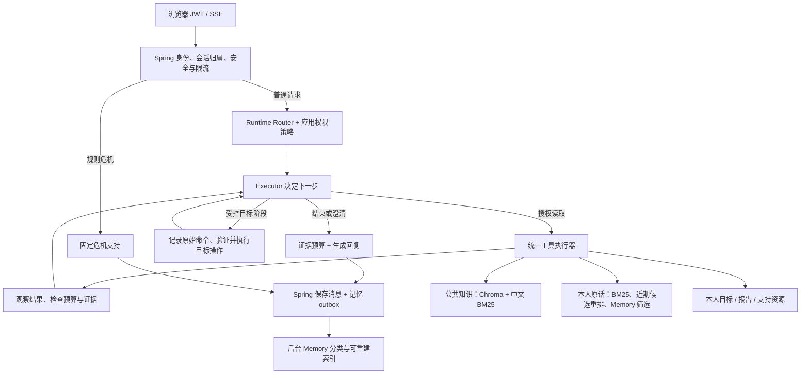

# Psych Agent

一个支持跨会话记忆、心理知识检索与目标推进的对话 Agent。前端展示流式回复、真实工具调用、目标小步骤、每周回顾和跨对话心理概要；Spring Boot 管理身份与业务事务，Python LangGraph 运行有权限和预算的 Agent Loop。

核心探索是 **JEV/Laya 风格的有限候选决策与对话生成分离**：Router 判断路线与风险，Executor 在授权范围内选择工具，Memory 筛选可追溯的用户原话。三个角色独立训练、校准和部署，最终回答由 DeepSeek Flash 或 Ollama 生成。

当前为开发研究项目，用于支持性对话，不替代心理咨询或医疗诊断。Qwen 接入是开发实验；记忆设计受 JEV-Mem 启发，未完整复现其四视图图检索。当前领域权重通过 [GitHub Release](https://github.com/Vaniloo/psych-agent-engineering/releases/tag/models-20261014) 发布，数据、配置与复现入口集中在 [训练目录](agent-runtime/training/README.md)。

## 从哪里读

先读 [架构与训练学习路线](docs/source-learning-roadmap.md)、[面试讲解](docs/interview-guide.md)，再读 [当前架构](docs/architecture.md)。这些说明以当前代码为准；带日期的训练与验收文档是当时的快照。

| 目录 | 负责什么 | 首先看 |
| --- | --- | --- |
| `frontend/` | 对话、目标、报告、工具活动与运行指标 | `app.js`、`tool-activity.js` |
| `backend/` | JWT、会话归属、目标事务、消息与 outbox | `AgentGatewayService.java`、`ConversationMemoryService.java` |
| `agent-runtime/psych_agent_runtime/` | 有界 loop、角色决策、证据检索、流式回答 | `graph.py`、`tool_controller.py`、`response.py` |
| `agent-runtime/training/` | 数据构建、训练、校准、评测与发布门槛 | [训练代码导航](agent-runtime/training/README.md) |
| `agent-runtime/knowledge/` | 公开心理知识快照、来源、导入与检索用例 | [语料说明](agent-runtime/knowledge/README.md) |
| `contracts/` | Python/Java 共用的风险与目标边界用例 | `decision-guard-cases.json` |

## 一轮对话怎样运行



常规只读预算两次，明确复合查询最多四次；相同工具和参数不重复执行。空结果可以进行一次受限查询修正。模型不能扩大工具权限、改变账号或自由构造写入参数。目标操作在最终回复前执行，回答依据真实保存结果；完整消息与记忆任务随后同事务保存。

## 当前模型分工

| 角色 | 当前开发模型 | 职责 |
| --- | --- | --- |
| Router | Qwen 4B LoRA · `psych-router-qwen4b-lora-20261012` | 类型、路线、风险和支持需要，契约 `psych-router-v2` |
| Executor / 工具 | Laya · `psych-executor-domain-v6` | 有限工具候选、finish / clarify，契约 `psych-executor-v2` |
| Executor / 目标 | Qwen 4B LoRA · `psych-executor-qwen4b-lora-20261012` | 创建授权、既有行动匹配与进度类型，同一 Executor 角色按任务分工 |
| Memory | Qwen 4B LoRA · `psych-memory-qwen4b-lora-20261012` | 分类、相关性与充分性，契约 `psych-memory-v4` |
| 候选重排 | 原始 Qwen3-Reranker-0.6B | 近期记忆候选重排，未微调 |
| 回答与目标规划 | DeepSeek Flash / Ollama | 自然语言生成与结构化目标拆解 |
| 知识嵌入 | Ollama `nomic-embed-text` | 768 维知识向量 |

这是三个决策角色，当前涉及四个决策 worker，另有独立重排服务。Runtime 不加载 Torch；模型权重由独立进程管理。角色不可用或拒判时走受限回退，具体行为见 [角色契约与部署](docs/local-laya-agent.md)。

## 已实现的工程能力

- **跨会话原话证据**：MySQL 是事实源，SQLite WAL 是派生索引。显式个人回顾通过同一 `memory_search` 补查近期已保存原话，处理后台索引延迟；按账号、说话者、日期和最新表达筛选。
- **可追溯 RAG**：公开语料保留来源、许可、版本和原文，MySQL 保存后分块嵌入 Chroma；中文 BM25 与向量检索融合，支持幂等导入和重建。开发环境已有 311 个知识片段，中文译文尚未全量人工审核。
- **目标闭环**：明确命令创建目标与小步骤；聊天进展需要原话、所有权、行动候选、版本和幂等验证。手动完成步骤后先保存事实，再生成下一步；部分进展不计为完成。
- **轻量故障兜底**：应用保障明确读取、限制模型权限、验证证据来源；查询修正最多一次，写操作不做不确定的传输重放。
- **运行可观察**：SSE 显示真实工具调用与结果，指标记录当前模型、TTFT、耗时、降级和保存状态。普通流式请求默认 4 路处理 + 4 路短队列，超载快速返回 503。

## 快速启动

需要 Docker Compose。默认规则决策 + Ollama 生成可以运行基础链路，不包含本项目训练权重。

```bash
git clone git@github.com:Vaniloo/psych-agent-engineering.git
cd psych-agent-engineering
git checkout feat/local-decision-router
cp .env.example .env
```

修改 `.env` 中独立的 JWT secret、内部服务 token 和数据库密码，然后运行：

```bash
docker compose up --build
```

默认前端 `http://localhost`，业务 API `http://localhost:8080`；Runtime、MCP、数据库和索引服务仅在 Compose 内网。首次启动会下载 Ollama 模型。Compose 全栈构建尚未在当前混合模型配置下验收；当前真实联调使用本机服务和远程 GPU worker。

使用 DeepSeek 生成，在服务端 `.env` 设置 `AI_PROVIDER=deepseek`、`DEEPSEEK_API_KEY` 和 `DEEPSEEK_MODEL=deepseek-flash`。Java 与 Python 使用相同生成提供方，嵌入仍由 Ollama 处理。密钥不进入浏览器或 Git。

本机开发需要 Java 17、Python 3.11+、uv，以及 MySQL、Redis Stack、Chroma、Ollama；参见 [部署说明](docs/deployment.md)。训练与接入 worker 另见 [训练导航](agent-runtime/training/README.md)。

## 检查

```bash
cd agent-runtime
uv sync --extra dev
uv run ruff check .
uv run pytest -q
cd ../backend
./mvnw test -q
cd ..
node --test frontend/tests/*.test.cjs
```

当前自动化结果与实服务验证范围见 [测试报告](docs/test-report.md)。历史容量、同题模型对照与检索诊断分别保留，不把开发成绩当作临床效果或最新 loop 的生产容量。

## 深入资料与边界

- [面试讲解](docs/interview-guide.md)：30 秒介绍、关键取舍、代码阅读顺序与常见追问。
- [架构](docs/architecture.md) / [工具层](docs/agent-tools.md) / [MCP](docs/mcp.md)：请求、写入和权限边界。
- [Loop 第一版](docs/agent-loop-v1-20261014.md) / [跨会话状态回顾](docs/personal-state-recall-20261014.md)：行为与验收记录。
- [Qwen Memory 训练](docs/qwen-memory-finetune-20261012.md) / [Router 与 Executor 对照](docs/qwen-router-executor-finetune-20261012.md)：模型收益、错误接受与实验限制。
- [50用户试用模拟](docs/launch-simulation-20261014.md) / [容量与回复优化](docs/optimization-20261013.md) / [知识语料](docs/psych-knowledge-corpus-20261014.md)：已有工程证据。

仍未实现完整中断续跑、同会话并发轮次排序、全历史记忆向量召回和完整 JEV-Mem 四视图检索。模型存在拒判和错误接受；训练标签以程序场景及开发复核为主，缺少独立人工真实对话金标。最新 loop 已完成50账号的四分钟混合试用场景与50请求突发验证；正式部署拓扑和长期稳定性仍待验证。项目不宣称公开生产或临床可用。
