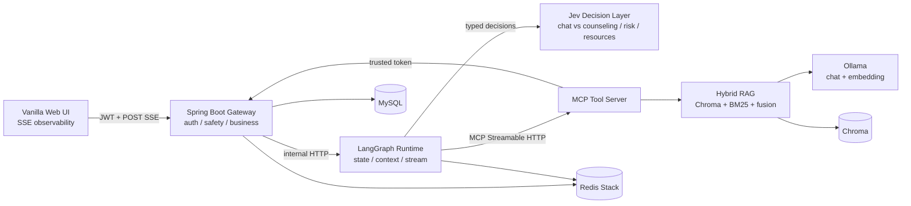

# Psych Agent

一个面向工程面试演示的心理支持智能体：Spring Boot 负责身份、业务数据和安全入口，Python LangGraph Runtime 负责状态图编排、流式生成、上下文预算与记忆压缩，MCP Sidecar 负责标准化工具调用，Chroma + BM25 提供混合 RAG。

当前重构重点是 **Jev 分层决策 Agent**：先判断普通聊天与心理支持，再为心理支持判断风险与专业资源需求，由程序选择陪伴、知识、自助、专业资源或危机流程。Jev 做结构化选择，生成模型负责表达，统一能力注册表约束工具。官方 Jev 通过 API 接入；独立开源 Laya 的本地微调已验证六类路由，尚未训练心理风险头。见 [Jev 决策设计](docs/jev-agent.md) 与 [本地微调](docs/local-routing.md)。

> 本项目提供的是支持性对话与工程演示，不替代心理咨询、医学诊断或紧急服务。

## 核心架构



主请求链路：

1. 前端用 JWT 向 Spring Boot 发起 `POST /agent/chat/stream`。
2. Spring 在读取会话、调用工具或模型之前执行确定性高风险扫描。
3. 普通请求进入 LangGraph；高风险请求直接进入固定危机支持流程。
4. LangGraph 加载结构化记忆，规划工具，通过 MCP 调用知识库或 Dashboard。
5. 上下文预算器裁剪历史与引用，Ollama token 通过 SSE 实时返回。
6. 达到阈值时压缩短期对话为会话摘要、中期记忆、长期记忆和画像补丁。
7. 本轮消息与压缩结果回写 Spring/MySQL；LangGraph checkpoint 写入 Redis Stack。
8. Python Runtime 不可用且尚未输出 token 时，Spring 自动降级到原 Java Agent。

## 工程能力

- LangGraph 显式状态图、条件边、Redis checkpoint、节点级流式事件
- Jev 分层结构化决策、概率门槛、风险升级与独立资源路径
- 统一工具参数与结果校验、能力超时、受限回退、避免不确定写入重放
- MCP Streamable HTTP 工具服务；身份参数由受信任网关注入
- Chroma 显式向量、中文 BM25、RRF/加权融合、可选 LLM rerank
- Token 预算、历史裁剪、引用预算、超长会话记忆压缩
- POST SSE：`meta/status/plan/decision/evidence/tool/context/token/memory/warning/done/error`
- 双重确定性风险门、固定危机回复、告警事件持久化与异步分发
- MySQL 业务数据、Redis 热记忆/缓存/限流/Stream、Chroma 向量索引
- JWT、USER/ADMIN 授权、内部服务 token、用户数据范围隔离
- Java 主网关 + Python Agent Runtime 双层降级
- Actuator + Prometheus Runtime 指标 + request ID
- 真实 Ollama Token/吞吐/TTFT、LangGraph 节点耗时、本地成本与云端等价成本口径
- MySQL 指标历史、P50/P95/P99 趋势面板、21 条标注集的 Recall/MRR/nDCG RAG 评测
- 精细化前端 Agent 工作台：执行时间线、上下文预算、记忆、RAG 引用与运行看板

## Docker Compose 启动

需要 Docker Desktop，并为 Ollama 模型预留足够磁盘空间。

```bash
cp .env.example .env
# 修改 JWT_SECRET、INTERNAL_SERVICE_TOKEN 和数据库密码
docker compose up --build
```

访问：

- 前端：`http://localhost`
- Spring 健康检查：`http://localhost:8080/actuator/health`

Agent Runtime 和 MCP Server 只暴露在 Compose 内部网络，浏览器不能绕过 Spring 身份边界直接访问它们。

## 分进程本地开发

先启动 MySQL、Redis Stack、Chroma 和 Ollama，再复制配置：

```bash
cp local.env.example local.env
ollama pull qwen3.5:4b
ollama pull nomic-embed-text
```

依次在不同终端启动：

```bash
./scripts/start-mcp-server.sh
./scripts/start-agent-runtime.sh
./scripts/start-backend.sh
./scripts/start-frontend.sh
```

本地前端地址为 `http://localhost:5173`。Python 脚本使用 `uv` 创建隔离环境。

## 验证

```bash
cd backend
./mvnw test

cd ../agent-runtime
uv sync --extra dev
uv run pytest
uv run ruff check .

cd ..
node --check frontend/app.js
docker compose config --quiet
```

## 面试学习计划

目标不是背代码，而是能够沿着一次真实请求讲清楚：为什么这样拆分、数据如何流动、故障如何降级、效果如何量化。建议每天投入 2～3 小时，按“阅读源码 → 画链路 → 本地验证 → 口述复盘”的节奏完成。

### 推荐源码阅读顺序

1. `docker-compose.yml`、`.env.example`：先建立进程、端口、存储和依赖关系的全局视图。
2. `backend/.../AgentController.java`、`AgentGatewayService.java`、`AgentRuntimeClient.java`：理解鉴权后的主请求入口、SSE 转发与 Java 降级。
3. `agent-runtime/psych_agent_runtime/api.py`、`graph.py`、`schemas.py`：理解 LangGraph 状态、节点、条件边和事件协议。
4. `planner.py`、`mcp_client.py`、`mcp_server.py`：理解工具规划、MCP 边界、可信身份注入和失败回退。
5. `rag.py`、`bm25.py`、`chunking.py`、`evaluation.py`：理解知识入库、向量召回、关键词召回、融合排序和离线评测。
6. `token_budget.py`、`memory.py`、`ollama_client.py`：理解上下文窗口、响应预留、记忆压缩和真实流式生成。
7. `safety.py`、Spring 风险检测与安全配置：理解双层风险门、危机流程和数据隔离。
8. `telemetry.py`、`observability.py`、`AgentMetricsService.java`：理解耗时、TTFT、Token、成本、RAG 指标的采集与聚合。
9. `frontend/app.js`、`index.html`、`styles.css`：理解 POST SSE 消费、执行时间线和可观测性面板。

### 10 天计划

| 天数 | 学习主题 | 必做实操 | 面试验收 |
| --- | --- | --- | --- |
| Day 1 | 系统边界与部署拓扑 | 启动全栈，画出浏览器、Spring、Runtime、MCP、Ollama、三类存储之间的调用图 | 3 分钟讲清楚为什么 Java 管业务、Python 管 Agent |
| Day 2 | Spring 网关与 SSE | 跟踪一次 `/agent/chat/stream`，记录全部 SSE 事件及异常路径 | 解释 POST SSE、首 Token、断流和未输出前降级 |
| Day 3 | LangGraph 状态机 | 从 `START` 逐节点跟踪普通请求与高风险请求，画出条件边 | 不看代码讲出 State、Node、Edge、Checkpoint 的职责 |
| Day 4 | MCP 与工具治理 | 分别让规划器触发知识检索和 Dashboard 工具，再停掉 MCP 验证回退 | 解释 MCP 相比直接函数调用的价值、代价与信任边界 |
| Day 5 | RAG 入库与混合召回 | 新增一篇知识文档，观察切块、Embedding、Chroma Upsert 和 BM25 索引 | 讲清 Dense、Sparse、融合、Rerank 各自解决什么问题 |
| Day 6 | RAG 评测与调优 | 跑 21 条标注集，记录 Recall@K、MRR、nDCG、P95，并修改一个参数对比结果 | 能说明离线指标为何不能直接等价于最终回答质量 |
| Day 7 | 上下文与记忆工程 | 构造长会话触发裁剪和压缩，检查短期摘要、中期记忆、长期记忆及画像补丁 | 讲清 Token 预算、信息损失、记忆污染和压缩时机 |
| Day 8 | 安全、权限与降级 | 测试高风险文本、越权会话、无效内部 Token、Runtime 不可用 | 讲清双重风险门、固定危机回复和 fail-safe/fail-open 选择 |
| Day 9 | 可观测性与性能 | 从前端和指标接口核对总耗时、节点耗时、TTFT、吞吐、Token 与成本 | 能从一条慢请求定位是检索、模型、工具还是网络瓶颈 |
| Day 10 | 故障演练与模拟面试 | 依次停掉 Chroma、Redis、MCP、Runtime，整理现象、告警和恢复方式 | 完成 10 分钟项目陈述，并回答 5 个架构追问和 3 个故障题 |

### 每日输出模板

- 一张图：当天模块的调用链或数据流。
- 一份证据：日志、SSE 事件、指标截图或评测结果。
- 三个取舍：当前方案、备选方案、选择理由。
- 两个故障点：触发方式、系统表现、定位路径和改进措施。
- 一段口述：用 3 分钟回答“这个模块在生产环境中解决了什么问题”。

完成标准：能够从用户输入一路讲到消息落库，并对 LangGraph、MCP、混合 RAG、上下文压缩、SSE、向量数据库、成本与召回率给出源码位置、运行证据和工程取舍，而不是只描述概念。

## 文档

- [系统架构](docs/architecture.md)
- [RAG Pipeline](docs/rag-pipeline.md)
- [模型工程细节](docs/model-engineering.md)
- [MCP 设计](docs/mcp.md)
- [部署与运维](docs/deployment.md)
- [面试讲解提纲](docs/interview-guide.md)

技术实现参考：[LangGraph persistence](https://docs.langchain.com/oss/python/langgraph/persistence)、[MCP Python SDK](https://github.com/modelcontextprotocol/python-sdk)、[Chroma collection API](https://docs.trychroma.com/docs/collections/manage-collections)、[Ollama API](https://docs.ollama.com/api/introduction)。
