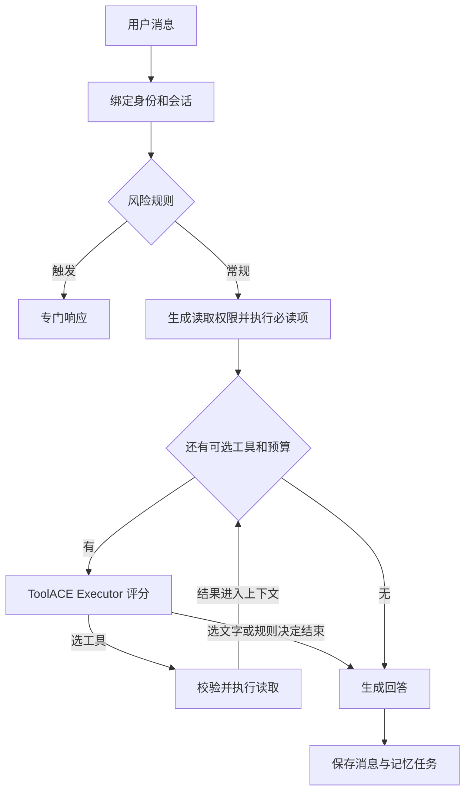

# Attune · 单 Executor 面试版

Attune 是一个可以回顾历史对话、查询心理知识和跟踪目标的对话 Agent。运行链路只接一个自训 LoRA，负责从当前允许的读取工具和文字回复中选择下一步。回答由独立的通用生成模型完成。

## 跟一条消息走

以“你还记得我上次最担心什么吗？”为例。Spring Boot 绑定账号与会话，Python Runtime 扫描风险、按规则生成本轮允许的工具。用户明确要求回忆时，程序先读取本人的原话。还有可选工具时，Executor 根据已有观察给候选动作排序。选中文字后，生成模型依据证据组织回答。消息与记忆任务通过事务保存。



- **路由与风险**使用规则。身份、权限、读取去重、期限和次数预算都由宿主执行。
- **记忆**沿用按账号保存的消息、近期上下文和词法检索。知识库沿用 BM25 与通用 embedding 的混合召回。
- **目标**沿用显式指令、归属与业务状态校验。聊天中创建目标需要明确授权。部分规划和复核仍可使用同一个通用生成服务。
- **故障回退**由控制器执行允许范围内的默认动作。运行轨迹记录每步实际来源，可区分必读规则、LoRA 和故障回退。

## 模型与证据

基座是 Qwen3-Reranker-4B，监督来自 ToolACE 示范里的下一步动作。输入包含对话、观察、工具描述与参数 Schema。对每个候选计算 yes/no logit 差，选择分数最高的动作。模型只选择读取操作和文字交接，用户身份、写权限与业务参数由程序绑定。

| 已有开发评测 | 基座 | ToolACE LoRA |
| --- | ---: | ---: |
| 公开测试集与示范动作一致率 | 80.65% | 93.36% |
| 项目首动作，22 题各换两种顺序 | 26/44 | 36/44 |
| 同一轮隔离 graph 回放 | 11/12 | 10/12 |

[训练过程](docs/public-tool-next-action-20261019.md)和[项目回放](docs/public-tool-project-replay-20261019.md)记录了原实验条件。这些是重构前的对照。个人记忆漏选是保留必读规则的具体原因。

## 运行

从根目录复制 `.env.example` 为 `.env`，设置自己的数据库密码、JWT 和内部服务密钥。设置生成服务及可用的聊天与 embedding 模型。Compose 使用 `.env`，本机开发脚本使用 `local.env.example` 对应的 `local.env`。

1. 在装有 CUDA 的机器上进入 `agent-runtime`，运行 `uv sync --extra executor`。运行 `uv run --extra executor python -m training.fetch_artifacts` 获取 ToolACE 权重。Release 访问与基座恢复见[训练交接](docs/model-training-handoff.md)。
2. 在 GPU 机器设置私有的 `PUBLIC_TOOL_API_KEY`。用以下命令启动唯一的评分服务，`BASE_SNAPSHOT` 为 Qwen3-Reranker-4B 的快照目录，目录名须为 `22e683669bc0f0bd69640a1354a6d0aebcfeede5`。

   ```sh
   uv run --extra executor python -m psych_agent_runtime.public_tool_service \
     --base "$BASE_SNAPSHOT" \
     --checkpoint training/artifacts/20261020/models/toolace-qwen4b-20261019 \
     --port 8093
   ```

3. 服务监听 GPU 机器的回环地址。使用 lab 时可在开发机运行 `ssh -N -L 8093:127.0.0.1:8093 lab`。应用的 `EXECUTOR_API_KEY` 与 worker 密钥一致，`EXECUTOR_BASE_URL` 必须从应用进程可达。示例分别给出 Docker Desktop 和本机进程的地址。
4. 根目录执行 `docker compose up --build`，浏览器访问 `http://localhost`。仅调试业务流程时可设 `EXECUTOR_PROVIDER=rules`。在运行指标页核对 Executor 实际状态和调用来源。

## 读源码

[规则路由](agent-runtime/psych_agent_runtime/planner.py) → [有界工具循环](agent-runtime/psych_agent_runtime/tool_controller.py) → [读取评分客户端](agent-runtime/psych_agent_runtime/public_tool_client.py) → [训练代码](agent-runtime/training/public_tools/README.md)。

此前的多模型训练材料和带日期的评测文档保留作历史对照。当前配置以本页及两个环境示例为准。
