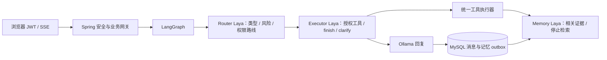

# Psych Agent

心理支持 Agent：Spring Boot 管身份、风险规则、业务归属和事务，LangGraph 管执行链路，三个独立本地 Laya 角色管语义决策，Ollama 生成回复。重点是 Jev 风格的受控决策层：先确定工具权限，再在权限内选择工具，记忆控制独立训练。



项目提供支持性对话和工程演示，不替代心理咨询、医学诊断或紧急服务。

## 已实现

- 三角色独立契约、服务、配置、概率门槛与规则回退；未训练也能运行固定流程。
- 应用持有工具权限，Executor 最多两次只读工具调用，读取结果后再选择下一步。
- 双重规则风险门、固定危机回复、模型风险升级、必需专业资源读取。
- 一套工具注册表：知识、本人记忆、目标/行动/反馈、报告与支持资源；默认本地执行，可选 MCP。
- 用户明确保存目标、行动/练习和反馈，JWT 归属与乐观版本校验；模型不写目标。
- 消息与后台记忆任务同事务保存，用户 + requestId 幂等；记忆原始观察与助手建议隔离。
- Chroma + 中文 BM25 混合知识检索、上下文预算、Ollama SSE、执行事件与运行指标。
- 内部服务 token、用户隔离、Redis checkpoint，以及既有报告、角色卡、知识管理和告警业务。

新三角色尚未训练。已有六类路由权重只是旧 v1 实验，不能当作风险模型或加载到新契约。记忆当前是 Jev-Mem 启发的第一阶段证据索引，尚未实现完整四视图图检索。旧 Java Agent/ToolRegistry、官方决策接口及同步记忆压缩已删除。

## 启动

```bash
cp .env.example .env
# 修改 JWT_SECRET、INTERNAL_SERVICE_TOKEN 和数据库密码
docker compose up --build
```

前端 `http://localhost`，Spring `http://localhost:8080`。默认三角色 `*_PROVIDER=rules`、`TOOL_TRANSPORT=local`。模型 worker 的可选 Compose 配置、独立 API key 与检查点接入见 [三 Laya 设计](docs/local-laya-agent.md)。

分进程开发：复制 `local.env.example` 为 `local.env`，启动 MySQL、Redis、Chroma、Ollama 并准备聊天/embedding 模型，再运行 `scripts/start-agent-runtime.sh`、`scripts/start-backend.sh` 和 `scripts/start-frontend.sh`。MCP 模式另启动 `scripts/start-mcp-server.sh`。前端默认 5173。

lab 上训练环境、缓存、数据、权重、日志全部放在数据盘；本轮只重构架构，没有启动新的训练。

## 验证

```bash
mvn -f backend/pom.xml clean test
uv run --directory agent-runtime --extra dev pytest
uv run --directory agent-runtime --extra dev ruff check .
node --check frontend/app.js
docker compose config --quiet
```

自动化覆盖契约、权限、风险升级、记忆隔离、幂等保存、目标版本和 H2 事务。模型服务边界测试使用模拟权重，不能当成新模型效果或完整全栈验收。

## 阅读顺序

1. [架构与故障边界](docs/architecture.md)
2. [三 Laya、部署与训练契约](docs/local-laya-agent.md)
3. [统一工具层](docs/agent-tools.md) 与 [MCP](docs/mcp.md)
4. [模型工程与记忆](docs/model-engineering.md)
5. [知识检索](docs/rag-pipeline.md)、[部署](docs/deployment.md)
6. [公开对话数据](docs/dialogue-datasets.md) 与 [旧路由基线](docs/local-routing.md)

源码入口：Java `AgentGatewayService`，Python `graph.py`、`decision_contract.py`、`route_policy.py`、`tool_controller.py`、`capabilities.py`、`memory.py`。
