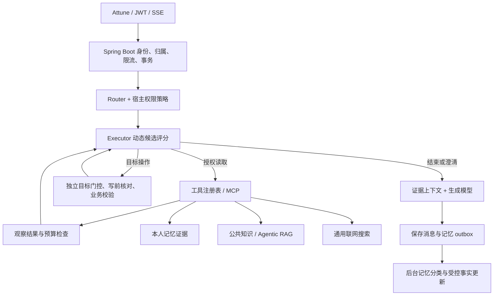

# Attune

一个支持跨会话记忆、心理知识检索和目标推进的对话 Agent。采用原生网页、Spring Boot 和 Python / LangGraph 有界工具循环。核心探索是 **JEV 风格的有限候选判断与自然语言生成分离**：本地模型判断路线、工具和记忆，生成模型负责回答与下一步计划。

**冻结版本：[`freeze-20261020-attune`](https://github.com/Vaniloo/psych-agent-engineering/releases/tag/freeze-20261020-attune)**。这是开发研究项目，未宣称公开生产或临床可用。当前主决策模型是 Qwen LoRA；没有使用官方 JEV 服务，也没有完整复现 JEV-Mem 四视图图检索。

## 已实现

- **有界 Agent Loop**：工具结果回到决策上下文，支持继续读取、结束或澄清；宿主控制权限、参数、去重、期限与预算。
- **动态 MCP 工具**：根据描述和 JSON Schema 评分，授权后可以热加载；身份和业务参数由应用绑定，模型不能扩权。
- **跨会话记忆**：消息与 outbox 同事务保存；近期原话、分类候选和受控长期事实账本协作，保留来源、修订、撤销及实际更新状态。
- **Agentic RAG**：查询规划、向量/BM25混合召回、本地知识重排、证据核对，最多一次补检索。336条资料、454个片段，保留来源、许可和原文。
- **目标闭环**：对话创建、同步部分/完成进度、反馈驱动的后续步骤调整与主动收尾；先保存完成事实，再规划，支持撤销。读取目标时带出近期保存记录。
- **可观察交互**：流式回答、真实工具活动、记忆提示、目标回顾、跨对话报告与运行记录；账号菜单支持自定义生成模型API，凭据服务端加密保存。
- **陪伴风格与搜索**：人设、示例影响语气；通用联网搜索参与loop。角色语气专用搜索已停用，世界书不进入当前回复上下文。

## 架构



默认最多8次读取、60秒期限；具体路由可分配更小预算。写操作不由自由读取循环直接授权；危机流程保留固定边界。

| 模块 | 当前本地模型 / 契约 | 职责 |
| --- | --- | --- |
| Router | Qwen 4B LoRA / `psych-router-v2` | 路线、对话类型、风险与支持需要 |
| 工具 Executor | ToolACE Qwen 4B / `public-tool-next-action-v1` | 动态候选下一动作选择；Laya v6保留故障回退 |
| Memory | Qwen 4B / `psych-memory-v4` | 分类、相关性与充分性 |
| 长期事实生命周期 | 独立 Qwen 4B LoRA v2 | 来源复核、合并与更正，显式账号范围内启用 |
| 目标门控 | 独立 Qwen 4B / `psych-goal-gate-v1` | 结合生成模型写前核对，后端校验保存凭据 |
| 旧目标决策 | Qwen 4B / `psych-executor-v2` | 兼容与回退路径 |
| 记忆 / 知识重排 | 原版 Qwen3-Reranker-0.6B | 独立任务和指令，不微调、不混用事实规则 |
| 回答与规划 | DeepSeek Flash / Ollama / 用户兼容API | 与本地决策权重分离 |

三个决策角色不等于三个进程。Runtime不加载Torch，GPU模型独立运行；默认配置不自动启用实验白名单。

## 读代码

| 目录 | 内容 | 入口 |
| --- | --- | --- |
| `frontend/` | 对话、目标、报告、模型API设置 | `app.js`、`tool-activity.js`、`model-api.js` |
| `backend/` | 身份、会话、目标事务、加密凭据 | `AgentGatewayService`、`ConversationMemoryService`、`GoalService` |
| `agent-runtime/psych_agent_runtime/` | loop、工具、证据、模型客户端 | `graph.py`、`tool_controller.py`、`public_tool_contract.py` |
| `agent-runtime/training/` | 现用训练、校准、评测与权重获取 | [训练导航](agent-runtime/training/README.md) |
| `agent-runtime/knowledge/` | 有来源语料、重建与检索用例 | [知识库说明](agent-runtime/knowledge/README.md) |

建议按 [源码学习路线](docs/source-learning-roadmap.md) → [当前架构](docs/architecture.md) → [冻结说明](docs/freeze-20261020.md) 阅读。带日期的实验报告是历史快照，不能直接作为当前配置。

## 运行

```bash
git clone git@github.com:Vaniloo/psych-agent-engineering.git
cd psych-agent-engineering
git checkout freeze-20261020-attune
cp .env.example .env
```

配置独立的JWT secret、内部服务token和数据库密码。规则决策 + Ollama基础链路：

```bash
docker compose up --build
```

默认前端 `http://localhost`，业务API `http://localhost:8080`。本轮实际联调使用本机服务和远程GPU，没有重新验收混合模型的完整Compose部署。本地SQL为文件H2，部署配置支持MySQL；Redis、Chroma、Ollama独立运行。参见 [部署](docs/deployment.md) 与 [模型服务](docs/local-laya-agent.md)。

默认DeepSeek配置保留在服务端环境变量；网页账号菜单“模型 API”可配置用户生成服务，覆盖聊天与理解/RAG步骤。Java侧目标规划和报告仍使用应用默认服务，见 [API范围](docs/model-api-settings-20261019.md)。

权重与训练见 [训练目录](agent-runtime/training/README.md)。新增适配器通过冻结Release附件分发；Router、基础Memory和Laya回退沿用 [models-20261014](https://github.com/Vaniloo/psych-agent-engineering/releases/tag/models-20261014)。基座从原作者获取并校验，大权重不进入Git历史。

## 验证与限制

冻结前完成Python、Java、前端测试，以及真实目标8轮、网关RAG 4场景和检索对照，见 [冻结说明](docs/freeze-20261020.md)。新增语料来源命中9/14→13/14，旧18题保持17/18，额外长句5/9→8/9；均为开发诊断，不是回答准确率、临床效果或总体未见工具成功率。

```bash
cd agent-runtime
uv sync --extra dev
uv run pytest -q
cd ../backend
./mvnw test -q
cd ..
node --test frontend/tests/*.test.cjs
```

工具评分尚未做项目概率校准；模型可能拒判或误选。候选窗口、译文审核、逐句来源约束、长期稳定性、同会话并发轮次排序与中断恢复仍有限制。历史50账号试用不等于50路同时推理容量。失败与边界保留在 [验证报告](docs/test-report.md) 和 [关键缺口修复](docs/critical-gaps-20261020.md)。
