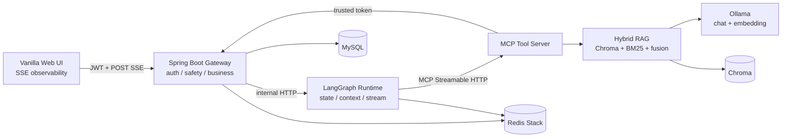

# Psych Agent

一个面向工程面试演示的心理支持智能体：Spring Boot 负责身份、业务数据和安全入口，Python LangGraph Runtime 负责状态图编排、流式生成、上下文预算与记忆压缩，MCP Sidecar 负责标准化工具调用，Chroma + BM25 提供混合 RAG。

> 本项目提供的是支持性对话与工程演示，不替代心理咨询、医学诊断或紧急服务。

## 核心架构



主请求链路：

1. 前端用 JWT 向 Spring Boot 发起 `POST /agent/chat/stream`。
2. Spring 在读取会话、调用工具或模型之前执行确定性高风险扫描。
3. 普通请求进入 LangGraph；高风险请求直接进入固定危机支持流程。
4. LangGraph 加载结构化记忆，规划工具，通过 MCP 调用知识库或 Dashboard。
5. 上下文预算器裁剪历史与引用，Ollama token 通过 SSE 实时返回。
6. 达到阈值时压缩短期对话为会话摘要、中期记忆、长期记忆和画像补丁。
7. 本轮消息与压缩结果回写 Spring/MySQL；LangGraph checkpoint 写入 Redis Stack。
8. Python Runtime 不可用且尚未输出 token 时，Spring 自动降级到原 Java Agent。

## 工程能力

- LangGraph 显式状态图、条件边、Redis checkpoint、节点级流式事件
- MCP Streamable HTTP 工具服务；身份参数由受信任网关注入
- Chroma 显式向量、中文 BM25、RRF/加权融合、可选 LLM rerank
- Token 预算、历史裁剪、引用预算、超长会话记忆压缩
- POST SSE：`meta/status/plan/tool/context/token/memory/warning/done/error`
- 双重确定性风险门、固定危机回复、告警事件持久化与异步分发
- MySQL 业务数据、Redis 热记忆/缓存/限流/Stream、Chroma 向量索引
- JWT、USER/ADMIN 授权、内部服务 token、用户数据范围隔离
- Java 主网关 + Python Agent Runtime 双层降级
- Actuator + Prometheus Runtime 指标 + request ID
- 真实 Ollama Token/吞吐/TTFT、LangGraph 节点耗时、本地成本与云端等价成本口径
- MySQL 指标历史、P50/P95/P99 趋势面板、21 条标注集的 Recall/MRR/nDCG RAG 评测
- 精细化前端 Agent 工作台：执行时间线、上下文预算、记忆、RAG 引用与运行看板

## Docker Compose 启动

需要 Docker Desktop，并为 Ollama 模型预留足够磁盘空间。

```bash
cp .env.example .env
# 修改 JWT_SECRET、INTERNAL_SERVICE_TOKEN 和数据库密码
docker compose up --build
```

访问：

- 前端：`http://localhost`
- Spring 健康检查：`http://localhost:8080/actuator/health`

Agent Runtime 和 MCP Server 只暴露在 Compose 内部网络，浏览器不能绕过 Spring 身份边界直接访问它们。

## 分进程本地开发

先启动 MySQL、Redis Stack、Chroma 和 Ollama，再复制配置：

```bash
cp local.env.example local.env
ollama pull qwen3.5:4b
ollama pull nomic-embed-text
```

依次在不同终端启动：

```bash
./scripts/start-mcp-server.sh
./scripts/start-agent-runtime.sh
./scripts/start-backend.sh
./scripts/start-frontend.sh
```

本地前端地址为 `http://localhost:5173`。Python 脚本使用 `uv` 创建隔离环境。

## 验证

```bash
cd backend
./mvnw test

cd ../agent-runtime
uv sync --extra dev
uv run pytest
uv run ruff check .

cd ..
node --check frontend/app.js
docker compose config --quiet
```

## 文档

- [系统架构](docs/architecture.md)
- [RAG Pipeline](docs/rag-pipeline.md)
- [模型工程细节](docs/model-engineering.md)
- [MCP 设计](docs/mcp.md)
- [部署与运维](docs/deployment.md)
- [面试讲解提纲](docs/interview-guide.md)

技术实现参考：[LangGraph persistence](https://docs.langchain.com/oss/python/langgraph/persistence)、[MCP Python SDK](https://github.com/modelcontextprotocol/python-sdk)、[Chroma collection API](https://docs.trychroma.com/docs/collections/manage-collections)、[Ollama API](https://docs.ollama.com/api/introduction)。
