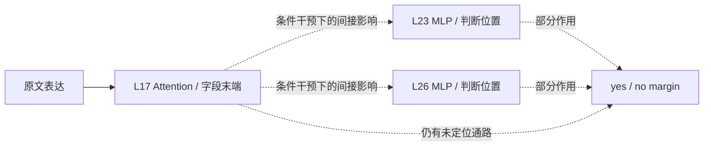

# 记忆模型激活定位 · 2026-11-04

本轮先测试和定位，**不修改 LoRA 或基座，不导出新模型，不接入正式服务**。沿用原始记忆生命周期 v2；前一轮权重范数/SVD 补丁没有收益，不能据此继续扩大参数消融。

源码：[`activation_diagnostics.py`](../agent-runtime/training/activation_diagnostics.py)；[固定案例与结果目录](../agent-runtime/training/experiments/activation-memory-20261104-v1/README.md)。所有层号均为代码中的 **0-based index**，例如 L17 对应 `model.layers[17]`。

## 为什么先做这一轮

参照 [Towards Best Practices of Activation Patching](https://arxiv.org/abs/2309.16042) 和 [How to use and interpret activation patching](https://arxiv.org/abs/2404.15255)，先比较运行行为，再把一个运行的指定激活临时移入另一个运行，观察输出变化。选择什么对照和指标会影响解释；能改变答案、Attention 权重大或中间读出偏向某个标签，均不等于已找到错误电路。

本轮检验的是指定输入、位置和组件上的干预效应，未完成每个注意力头、神经元及完整边路径的定位。后续不得直接将这些层当作可编辑目标。

## 1. 先复核失败与任务边界

原有 491 条开发边界挑战复跑仍为 **471/491** 符合标签。逐条审查原有 20 条不一致，主要包括：

- 本人和他人的事实混淆，如问“我每次骑车多久”，材料却是妹妹的骑车时间。
- 施受关系颠倒，如问“我给谁发了邮件”，材料却是别人发邮件给我。
- 中文预约更正漏识别，英文更正在这批样例里更顽固。
- 具体事件被末尾“不能说明长期偏好”的否定表达压过。
- duplicate、grounded、conflict 等任务边界：同一条候选是否重复、是否有原话支持、是否矛盾是不同问题；不能用一项结论替代其他任务。

原始标签未改。`failure-audit.json` 将 duplicate/conflict 相关案例标为需核对任务范围，其余条目也只是助手按现行契约审核，不是独立人工金标。

## 2. 固定行为对照，先观察是否稳定

冻结 **16 个失败家族、68 条表达**：每家族有原失败句、两条改写和一条相反标签的最小对照，另有 4 条来源角色对照。14 个家族是语义改写，2 个 duplicate 家族改变了任务不应依赖的 source 字段；后两者单独报告，不能冒充同义句。

这些是针对已知失败编写的开发诊断，不进入训练集，也不是新的一般能力评测。手工核对后，定位组与确认组在前向运行前预先分好。

68 条中 41 条符合标签；这个数字包含有意挑出的 16 条旧失败，不能当作记忆系统总体准确率。例子如下，margin 为该次固定批量下的 `yes_logit - no_logit`：

| 任务 | 原句与表现 | 改写与表现 |
| --- | --- | --- |
| relevance，本人时长 | 妹妹现在每次骑车十二分钟。→ 错误 yes，+14.06 | 妹妹骑一趟车会用十二分钟。→ 正确 no，−13.05 |
| write_worthy，本人关系 | 室友经常给我寄书。→ 错误 no，−6.25 | 我经常收到室友寄来的书。→ 正确 yes，+2.56 |
| write_worthy，预约更正 | 更正一下，上回说周二看诊记错了，其实是周三。→ 错误 no，−0.38 | 我更正自己的看诊预约：应该是周三，不是周二。→ 正确 yes，+10.38 |
| 英文施受关系 | My tutor emailed me. 及两种同义改写均误判为相关 | 无合格正确 donor，未强行定位 |
| 英文预约更正 | 原句及两种改写均判 no | 无合格正确 donor，未强行定位 |

能找到正确改写不表示问题已解决，而是表明这组事实并非任何表达都无法判断。两个英文家族没有可用 donor，保留为未覆盖问题。

## 3. 激活扫描方法

选择“anchor 判断错误，预先列出的第一条正确改写 signed margin 至少为 2”的配对，并在实际干预批量下重新确认。得到定位组 8 对、确认组 6 对；其中各有 1 对是任务无关字段控制，主要同义对照分别为 **7 对和 5 对**。主要确认组全部为中文，不能据此推断英文错误已定位。

对 36 层的 residual、Attention 输出、MLP 输出，在三个位置扫描，共 **324 个单点干预位置**：

1. 原文字段首 token。
2. 原文字段末 token。
3. 最终 yes/no 判断的输入位置。

位置用实际 tokenizer offset 对齐字段边界，处理不同句长和左 padding；字段首末不等于精确的实体/关系 token 对齐。缓存的是最后这些位置的向量，不以 Attention 热力图推断因果。

同时保存 logit lens 逐层读出，仅作描述性线索。排名只用定位组的同义对照；排除 residual 和最后两层，保留一个源字段位置，再选平均 signed margin 改善较大的不同层候选，层间距至少为 2。保存候选后，才在确认组进行控制实验。

### 确认组结果

下表仅统计 5 对同义改写对照；1 对 source 范围控制不混入：

| 位置 | 临时激活移入后转对 | 平均 signed margin 改善 | 同大小随机扰动转对 | 反向移入后正确 donor 仍正确 |
| --- | ---: | ---: | ---: | ---: |
| L17 Attention，原文字段末端 | 3/5 | +1.825 | 0/5 | 5/5 |
| L26 MLP，判断位置 | 3/5 | +4.294 | 0/5 | 3/5 |
| L23 MLP，判断位置 | 3/5 | +3.250 | 0/5 | 4/5 |

这是“临时替换后输出改变”，不是模型已被修复。三个恢复的案例都是相对低 margin 的错误；两个高 margin 的 episodic 漏判没有恢复。L17 在那两个高 margin 案例上甚至略微恶化，不能称为通用语义修复点。

自替换的分数差均为 0；L35 源字段位置的干预效应也为 0，符合最后一层逐 token 输出无法再向判断位置传播的结构性负对照。

初次同任务/同标签打乱 donor 仅覆盖确认组中的 2 对，不能将 0/2 与全部 5 对直接比较。后续增加来自既有挑战的异例同标签 donor，见下节。

## 4. 路径阻断：部分影响经过下游 MLP，但不是唯一通路

沿用已冻结的三个位置，不重新挑层。先在 L17 原文字段末端移入正确改写激活，再把 L23/L26 的 MLP 判断位置恢复为原错误运行的激活：

| 临时运行条件 | 同义确认组转对 | 相对原错误运行的平均 signed margin 改善 |
| --- | ---: | ---: |
| 不干预 | 0/5 | 0 |
| 移入 L17 正确激活 | 3/5 | +1.825 |
| 同时阻断 L23 | 3/5 | +1.363 |
| 同时阻断 L26 | 3/5 | +1.281 |
| 同时阻断 L23 和 L26 | 2/5 | +0.988 |
| 只移入由 L17 改变所诱发的两个 MLP 激活 | 1/5 | +0.931 |

两个下游点合并阻断后改善减少，但没有消失；只搬运其被 L17 改变的激活也不能复制全部改善。支持的是**条件下的部分中介作用**，不是已经隔离出唯一的 `L17 → L23 → L26` 电路。不能把两个均值的比值当作某段电路负责多少比例的推理。



虚线不表示已隔离的直接神经连接。将更早 L0 MLP 恢复为自身激活不改变 L17 的效果，差值为 0；所有点自替换亦为 0。额外三颗随机种子在 L17 分别使 1/5、1/5、0/5 转对，提示弱错误本身容易受扰动影响。

## 5. 更强的异例 donor 对照

本对照不重新选择层，也不调整权重：从原 491 条挑战里，按输入 hash 排序的前三条不同记录中选择同任务、同标签且正确 margin 至少为 2 的 donor；不按干预收益选择。全部 5 对同义确认案例及 1 对范围控制都找到合格异例。记录长度/语言未严格匹配，解释仍需保守。

| 位置 | 本例同义改写激活转对 | 内容无关、同任务同标签 donor 转对 |
| --- | ---: | ---: |
| L17 Attention，字段末端 | 3/5 | 2/5 |
| L23 MLP，判断位置 | 3/5 | 3/5 |
| L26 MLP，判断位置 | 3/5 | 3/5 |

例如，预约更正的 donor 来自“我这周开始每天走路去上班”；episodic 案例的 donor 来自另一段开会经历。它们共享任务和正确标签，却不包含当前事实。晚层 MLP 仍出现同样的转对数量，**不支持把这些位置解释为该事实特有的语义错误电路**。目前更符合通用分类/判断信号被搬运的解释，但这也只是受控实验下的推断，不是已完成电路识别。

L17 本例 donor 比异例多转对 1 条，样本仅 5 对，不足以证明语义特异性。其余三个随机种子有 0–1 条偶然转对，也表明低 margin 案例容易被扰动推过阈值。

## 6. 当前结论与下一步

**定位到了对判断有因果影响的候选位置，尚未定位到可安全编辑的错误电路。** 这比从权重范数直接消融多了行为、临时干预、反向和异例控制证据，但仍不能据此修改 LoRA。

继续研究时先扩充并复核跨表达确认组，保留两类没有正确 donor 的英文难例；然后把字段边界细化成主体、客体、关系和更正范围的 token span，在 L17 附近做逐 head/边级的受控检验，区分事实内容路径与通用 yes/no 信号。相关性、层间顺序、单点恢复均不自动授权权重编辑。本轮到此停止，不启动新训练或参数补丁。

## 7. 产物与复现

服务器独立目录：`/home/ubuntu/data/psych-agent-routing-20261009/runs/activation-memory-20261104-v1/`；本机会话归档：`outputs/activation-memory-20261104/`。

- `results-v2/`：行为记录、68 条及配对激活、logit lens、324 点扫描、冻结位置和确认实验。
- `path-results-v3/`：冻结位置的条件路径阻断、反向诱发和额外随机种子。
- `controls-results-v4/`：追加异例同标签 donor 控制，不重新排名。
- 对应 `source-v2/`、`source-path-v3/`、`source-controls-v4/` 保存实际执行的源码。
- `.safetensors` 文件是采集的**激活缓存，不是新模型权重**。

第一次评分接口误对仅含 query/evidence 的任务要求 source 字段，预检失败；随后将纯评分与需要字段定位的运行分开。CPU 预检通过 68 条实际 token 对齐和 491 条 renderer/长度检查后再运行，失败记录保留。样例、标签和原模型权重未因此修改。

在 CUDA 环境，从 `agent-runtime` 执行；路径应替换为实际 data 盘目录，输出目录必须不存在：

```bash
python -m training.activation_diagnostics \
  --base /data/base/22e683669bc0f0bd69640a1354a6d0aebcfeede5 \
  --checkpoint /data/models/qwen-memory-lifecycle-4b-lora-20261016-v2 \
  --cases training/experiments/activation-memory-20261104-v1/cases.json \
  --challenge training/experiments/memory-lifecycle-20261016-v2/challenge-cases.jsonl \
  --out /data/runs/activation-study/results --batch-size 16
```

路径阻断复用 `--path-from /data/runs/activation-study/results`，另写新 `--out`；`--matched-donor-controls` 增加异例 donor 对照。检查源数据/权重 hash、固定候选位置和模型参数版本；任何输出 hook 都在 `finally` 中解除，只替换输出的 clone，不修改参数。

主诊断 379 个前向批次、约 52.0 秒；首轮路径检验 16 个批次、约 11.7 秒，不包含首次失败和其他准备时间。参数全部冻结，源 adapter SHA 及所有模型参数版本保持不变，没有训练、模型导出或正式部署。测试和结果局限见实验目录。

异例 donor 追加控制 21 个批次、约 12.1 秒；三阶段合计 416 个前向批次。最终自替换和早层负对照的最大差值均为 0。逐例指标、源文件 SHA、激活缓存的形状/大小和固定位置选择已独立复核，详见实验目录的审计文件。

独立重算发现扫描表中 L16 residual/source_end 有 1 条零 margin 的 no 标签统计错误：服务约定零分判 yes，不能以 signed-zero 为正确 no。已修正分析函数并补充测试，原始分数保留，派生表为 `activation-sweep-audited.json`；该点是排除排名的 residual，不影响三个候选、确认组或路径结果。审计文件明确记录此修正，当前分析源码与实际执行快照的 SHA 分开保存。

后续已完成[第二阶段 head/语义范围诊断](head-span-memory-diagnostics-20261104.md)：扩大到 24 个家族、156 条表达，头级候选与 L17 整组移植未在新确认组恢复错误。第一阶段的候选证据因此进一步收窄，仍不支持修改权重。
