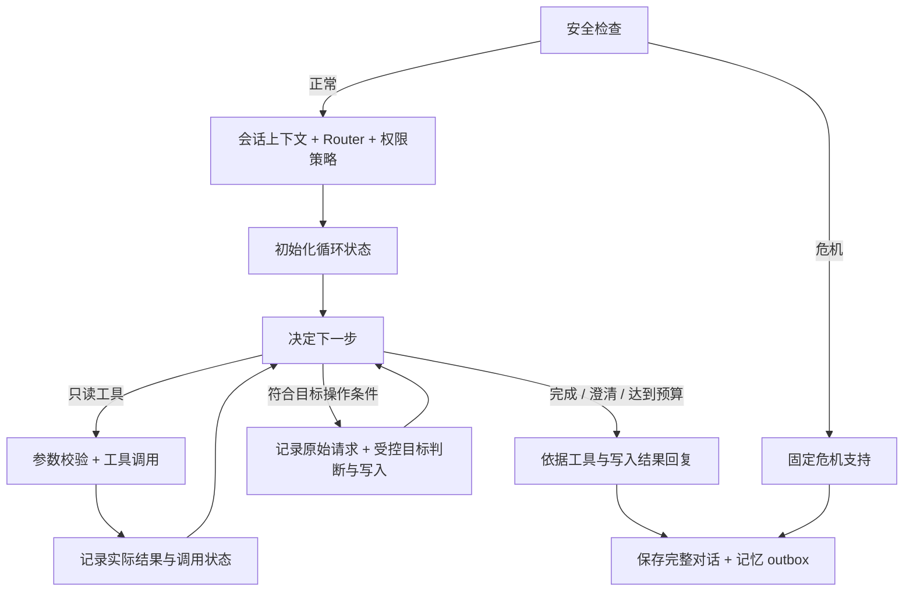

# 有界 Agent Loop 第一版 · 2026-10-14

正常对话统一进入 LangGraph 的决策、工具执行、观察循环。原来的六个业务分支不再分别编排相同的工具执行函数。Router 仍负责需求、风险和权限；本地 Laya Executor 在应用授权候选中选择工具、结束或澄清。原有模型权重、候选契约与接受阈值没有改变。

## 当前图

实际循环节点是 `agent_initialize → agent_decide → agent_tool → agent_observe → agent_decide`。受控目标节点 `agent_goal_write` 返回决策节点后进入最终阶段，不能再次执行目标写入。`_execute_tools` 仅保留为旧集成和测试的兼容入口。

## 决策与查询修正

- 常规只读预算仍为两次；直接闲聊可零调用，跨会话背景检索仍遵守原来的触发策略。
- 明确同时要求查看报告、目标、个人记忆和心理知识时，应用可以开放四项必要读取，最多四次。没有把所有工具默认开放给模型。
- 每次调用独立记录工具、参数、结果和状态，调用次数与剩余预算进入下一轮决策。相同工具和规范化参数不得重复执行。
- 当循环准备结束，且此前有空结果或不可用结果时，可以触发一次结构化查询修正。它复用当前生成提供商（开发环境为 DeepSeek Flash），最多等待八秒。
- 修正只能操作本轮已授权的心理知识、个人记忆和目标读取；知识/记忆只允许改 `query`，目标只允许改 `title/status`。已有明确目标状态过滤不得放宽。
- 身份、会话、结果数量、用途以及写入参数不能由修正模型修改。非法 JSON、越权工具、额外字段和重复参数均放弃修正。
- 修正可在常规预算外追加一次读取，总读取硬上限四次；整个只读阶段默认三十五秒。达到期限或预算后按已取得的事实回复，并保留失败信息。
- 原始观察保留在循环状态；修正失败或再次为空时，不以失败结果覆盖已有有效证据。最终回复仍使用受限工具上下文。

配置：`AGENT_LOOP_TIMEOUT_SECONDS=35`、`AGENT_LOOP_REFINEMENT_ENABLED=true`。关闭修正后仍保持同一图和本地 Executor 决策。

## 目标保存与回复顺序

此前链路先生成回复，再保存整轮，最后创建目标。因此回复只能表示准备创建，不能依据实际写入确认结果。

新链路在目标操作之前调用 `/internal/agent/begin-turn`：

1. 锁定实际账号，验证会话归属，记录原始用户命令及 requestId。
2. 记录使用 `ACCEPTED` 状态，助手回复为空；此时不插入占位聊天消息，也不派发记忆任务。
3. 目标创建继续核对服务端原始命令、本人来源目标和同会话上下文；目标进度继续核对实际行动、版本、原话和用户自动同步偏好。
4. 写入工具返回真实结果后，目标卡片和最终回复才确认保存或同步。单独创建目标的回复使用已保存的名称、步骤和标准；包含其他查询的请求继续由生成模型综合实际工具结果回复。
5. 最终 `persist-turn` 在一个事务中保存用户/助手消息并把同一 receipt 转为 `PENDING`，后台记忆再消费。目标元数据不会在最终保存时被覆盖。

同一账号与 requestId 不得绑定不同原话或会话。目标创建保留原有幂等保护；完整请求重放读取已保存回复，不再次创建目标、保存消息或派发记忆任务。写操作不因网络错误自动重试。

进度查询复用循环中已有的本人目标结果，避免再次读取。补充修正了“目标”中的“标”及引用标题里的动作词导致回顾误触发进度检查的问题；复合句中的心理知识定义不会再屏蔽前面目标列表的读取意图。

## 可观察性

既有前端工具活动卡片继续展示每次真实调用及状态；查询修正后的第二次调用有独立活动 ID。目标卡片可以在最终文字回复之前出现。

Runtime 清单报告 `agentLoop=bounded-v1`、只读上限四次、修正上限一次、`goalResultBeforeReply=true`。运行指标新增 `pipeline.loop`：只读调用次数、有效预算、是否使用修正及是否进入受控目标阶段。阶段进入不代表实际发生写入，实际写入仍看工具回执和 createdGoals/goalUpdates。

## 验证与限制

- Python 全套 **492 项通过**；新增循环修正、身份与权限、状态过滤、重复调用、期限/预算、非法结构化返回、写入顺序和完成请求重放回归。
- 后端 **65 项：64 通过、1 项原有跳过**。真实 H2 集成验证原始请求→目标创建→最终消息/outbox 的顺序、元数据保留、幂等与原话冲突。
- 前端工具活动检查、Ruff 与差异检查通过。
- 合成账号的八轮完整联调全部保存：普通交流、心理知识、只想倾诉、目标创建、步骤进度、已完成目标、记忆查询和四项复合读取；创建一个目标并实际同步一次步骤进度。目标创建/同步均早于首个回复 token。
- 初次联调实际观察到空记忆查询经修正后第二次读取；修复读取边界后的复测同题已存在历史原话，未再次触发修正。两份结果分开保存，不把“同题重复”当作独立检索质量评测。
- 另检查完成请求重放和“创建目标＋解释知识”的混合请求。原始联调记录在会话 `outputs/agent-loop-v1-20261014/`；仅使用专用合成账号，不改真实用户目标。

这是有预算的第一版循环：结构化修正只负责检索参数，目标写入仍是独立受控阶段，未训练自由生成动作的 Executor，也没有新增每步评论员模型或复杂多 Agent 调度。只读阶段期限不覆盖目标规划和最终生成的独立超时。若目标已写入但最终回复保存失败，原始 receipt 保留，但完整中断恢复与同会话并发顺序仍未实现。检查点的存在不能代替这些能力。

本轮没有重新训练模型、扩大语料或执行新的容量压测；旧并发数据不能直接证明新循环的生产容量。短联调也不证明临床效果或所有同义表达都能正确识别。

## 设计参考

采用 [LangGraph 官方循环示例](https://docs.langchain.com/oss/python/langgraph/quickstart) 的决策/工具反馈结构，借鉴 [Anthropic 的有效 Agent 实践](https://www.anthropic.com/engineering/building-effective-agents) 中实际环境反馈与停止条件，以及 [LangChain 中间件](https://docs.langchain.com/oss/python/langchain/middleware/built-in) 的调用限制和错误返回设计。这里使用现有 LangGraph 图与工具边界实现这些机制，没有更换整个框架。
