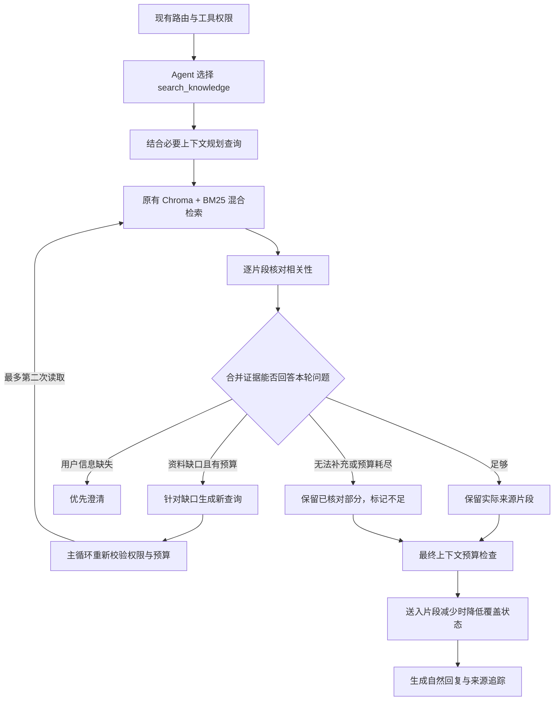

# Agentic RAG v1：查询规划、证据核对和有界补检索

2026-10-19 已接入本地开发运行时与前端。默认配置仍关闭，需要 `AGENTIC_RAG_ENABLED=true` 才启用；没有公开部署或推送。本轮没有更换模型权重，也没有修改记忆、目标、MCP 工具权限或心理知识语料。

## 解决的问题

原有 Agent 已能选择 `search_knowledge`，底层是 Chroma 向量检索、BM25 与融合排序。原有恢复仅处理空结果或服务失败，不能判断“返回了片段，但这些片段回答不了当前问题”。新版增加查询规划、相关性与充分性核对，并允许针对缺口补检索一次。



两次读取都由现有主循环执行，不在工具内部启动隐藏检索循环。其他必需读取的预算会被预留，知识补检索不能挤掉已要求的记忆读取。用户只想倾诉、不希望查询资料时，原有退出策略继续生效。

## 模型与来源分工

- 原有本地 Router、ToolACE Qwen 4B Executor 与 Memory 保持原有职责和权重。
- 查询规划、片段相关性与证据充分性核对使用现有生成客户端；当前开发配置为 **DeepSeek Flash**。这是结构化模型判断，不能称为已经训练好的本地 JEV 知识评估器。本轮没有启动训练。
- 代码根据模型返回的片段索引选取原始片段。模型不能生成引用正文、改写来源、指定新工具或修改分类过滤器。
- 规划最多读取最近六条同会话用户/助手消息，每条最多 500 字，只用于补全指代；不会额外查询跨会话记忆。历史助手的推测不能作为用户事实。
- 评估器最多看到 12 个候选、合计 12,000 字的完整片段，最终最多保留六条。超预算片段整段排除，不切掉末尾限定条件。第二轮合并第一轮已核对片段与新增片段，去重后重新核对。

## 停止与降级

状态包括 `sufficient`、`partial`、`insufficient`、`needs_user_input`。超时、服务故障或非法输出使用 `unavailable`，已有核对片段时保留为 `partial`。

- 最多两次知识读取，共享主循环总调用次数与截止时间，不提高全局预算。
- 默认知识阶段总预算 15 秒，单次模型判断上限 5 秒；受主循环剩余时间进一步限制。
- 相同查询做大小写和空白归一化后拦截。原有通用恢复不能为本轮知识检索发起第三次调用。
- 规划不可用时保留原本已授权的查询；评估不可用时，不接受本轮未经核对的新片段。
- 第二次读取或评估失败，保留第一轮已核对的来源并标记限制。
- 最终上下文预算如果删掉了部分片段，回答阶段的覆盖状态降为 `partial` 或 `insufficient`，不会沿用完整检索集的“足够”结论。
- 评估器的缺口说明只用于调试与补检索，不交给最终生成器作为来源，避免已淘汰资料的内容通过诊断说明进入答案。
- 不自动开放联网搜索；既有网络工具仍受原有权限策略控制。

足够与否针对用户实际需要判断。用户只问一般建议时，已有对应定性资料即可，不额外要求精确秒数、剂量或完整治疗计划。

## 展示与观测

前端消费 `knowledge_progress` SSE：理解检索问题、检索知识资料、核对资料依据、必要时补充检索资料、最终覆盖状态。这些是过程步骤，不增加“调用了几个工具”的计数；实际两次检索仍是两条真实工具调用。

`metrics.pipeline.agenticRag` 包含策略、实际轮数、保留片段数、停止原因、规划状态和最终回答上下文覆盖。规划与评估分别记录为 `knowledge_query_plan`、`knowledge_evidence_review` 模型调用。检索缓存仍缓存原始检索结果，不把用户上下文里的充分性结论缓存为全局结论。

## 验证结果

凭据清理后的记录见 [验收摘要](../agent-runtime/evaluation/agentic-rag-20261019/acceptance.json)、[真实语料诊断](../agent-runtime/evaluation/agentic-rag-20261019/read-loop-summary.json)、[网关 SSE 记录](../agent-runtime/evaluation/agentic-rag-20261019/gateway-results.json)。

- Python 回归：**1,021 通过、1 跳过**，包含 30 项新测试。覆盖两轮上限、过滤器保持、伪造来源索引拒绝、重复查询、服务异常、合并来源、完整片段预算、最终上下文裁剪与必需记忆读取预算预留。
- 前端现有测试全部通过；新增过程事件去重、非法事件过滤、真实工具计数和完成状态恢复检查。JS 语法、Compose 配置与差异空白检查通过。
- 使用当前 **311 片段**知识库和真实 DeepSeek，对六条开发者编写场景做只读诊断：指代、否定偏好、概念区别、具体参数、复合问题、虚构方法。诊断固定选择知识工具，不能用于证明路由准确率。
- 修订后六条知识读取阶段为 **1.867–4.192 秒**，中位数 2.344 秒，包含规划、读取、评估；不含最终生成，不是额外开销估计或并发 SLO。
- 使用新建隔离账号，从真实前端代理 → Java → Runtime → 模型/知识库跑四条 SSE 场景，路径验收 **4/4**。实际知识调用次数为 **1、2、2、0**，最后一项是“只想倾诉、不查资料”；前三条整轮约 7.1–9.0 秒。

这些是工程路径与边界验证，不是独立准确率或临床效果评测。**最终回复仍可能补充片段以外的常识性解释或建议**，例如咖啡摄入时间安排；本轮已收紧提示，但没有增加独立的逐句答案核验。评估器判定“证据足够”不等于最终答案完全忠实于资料。

首轮诊断发现评估器过度要求用户未询问的精确参数，以及缺口说明污染最终回复的问题；修正后复跑六条。两轮原始记录保留在本会话 `outputs/agentic-rag-20261019/round1`、`round2`，没有覆盖首轮结果。

## 运行、复现与回退

```dotenv
AGENTIC_RAG_ENABLED=true
AGENTIC_RAG_MODEL_TIMEOUT_SECONDS=5
AGENTIC_RAG_TIMEOUT_SECONDS=15
```

加载现有私有生成与向量服务环境后，从 `agent-runtime` 执行：

```bash
.venv/bin/python -m benchmarks.agentic_rag_probe \
  --cases evaluation/agentic-rag-cases.json \
  --out /absolute/path/to/new-diagnostic-directory \
  --generate
```

诊断不写聊天、目标或记忆；输出目录已存在时拒绝覆盖。当前本地开发环境已启用，可刷新前端测试。回退时设置 `AGENTIC_RAG_ENABLED=false` 并重载 Runtime，不需要回滚知识索引或业务数据。

切换时发现 SSH 控制连接过期，已恢复原有转发，Router/Executor/Memory 与长期事实服务恢复可用。独立目标门控端口当前没有监听，状态仍为 `unavailable`；本轮未启动、停止或修改该模型服务，RAG 验收不代表目标服务恢复。

结构参考 [LangGraph 官方 Agentic RAG 教程](https://docs.langchain.com/oss/python/langgraph/agentic-rag)，在现有主循环内实现权限、预算、来源与过程展示约束。
