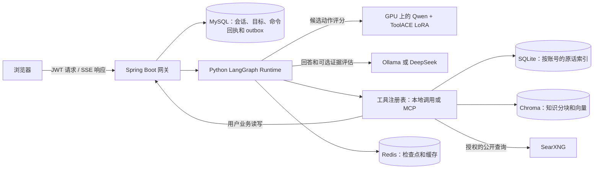
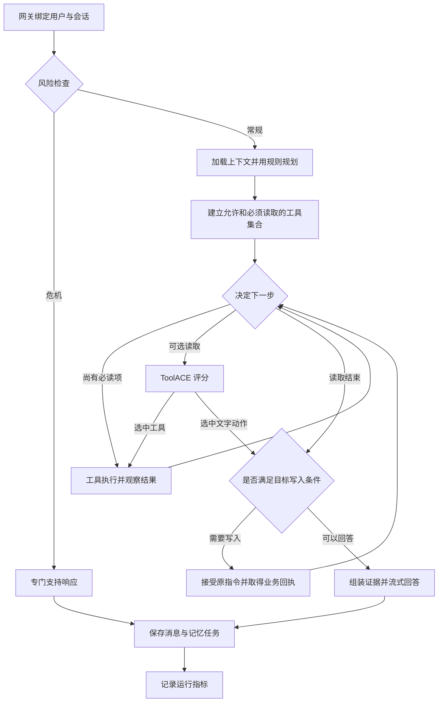

# 总架构 · 一次对话，三个决定

**规则决定这轮可以读什么，ToolACE 从允许的候选里选下一步，生成模型根据读到的证据组织回答。** 只有 ToolACE Executor 使用项目微调的 LoRA。Spring 持有账号、会话和业务事务，Python Runtime 用 LangGraph 串起一次请求。

## 部署和数据

Spring Boot 通过 MyBatis 读写 MySQL 的 15 张业务表。一次对话结束时，两条消息、会话摘要和待处理的记忆回执在同一个 Spring 事务中提交。目标更新同时匹配账号、目标 ID 和版本号，成功时版本加一，旧版本写入返回 HTTP 409。Flyway 管理表结构。[Mapper 接口](../backend/src/main/java/com/vanilo/psych/agent/repository) · [目标更新 SQL](../backend/src/main/resources/mappers/SupportGoalMapper.xml) · [数据库基线](../backend/src/main/resources/db/migration/V1__application_schema.sql)

后台消费者读取 outbox 中的记忆任务，把对话原话投影到 SQLite。公共知识切块后用 embedding 建索引，查询时再与 BM25 的词项命中合并。Docker 服务与 GPU 评分服务的地址、端口分开配置。[部署配置](../docker-compose.yml) · [启动说明](../HANDOFF.md)

## 一条请求怎么走

以“你记得我上次说喜欢做什么吗？”为例：规则可以把个人回忆列为必读；工具绑定当前账号，取回原话和会话来源。只有仍有可选读取时才需要评分。工具循环有次数和时间预算，评分服务断开时应用执行规则允许的默认动作。运行记录可看到本轮动作来自必读规则、Executor 还是故障回退。[图节点和条件边](../agent-runtime/psych_agent_runtime/graph.py) · [读取策略](../agent-runtime/psych_agent_runtime/route_policy.py) · [Executor 循环](../agent-runtime/psych_agent_runtime/tool_controller.py)

| 用户意图 | 系统怎么处理 | 能拿什么验收 |
| --- | --- | --- |
| 闲聊、报告、支持资源 | 闲聊可以直接回答；报告和支持资源按授权从业务工具读取。危机分支走专门支持响应。 | 运行轨迹中的路线、工具与回复来源。 |
| 回忆自己的经历 | 从本人原话索引查候选，按问题限定来源或时间；需要时补读近期消息，覆盖后台索引的延迟。 | 原话、会话、时间；换账号后证据应隔离。[Memory](../agent-runtime/psych_agent_runtime/memory.py) |
| 查询心理知识 | Chroma 向量和 BM25 混合召回。开启 Agentic RAG 后，规划查询、评估命中，只在存在缺口时补查一次。 | 查询轮数、保留的知识块和回答引用。[混合检索](../agent-runtime/psych_agent_runtime/rag.py) · [证据评估](../agent-runtime/psych_agent_runtime/agentic_rag.py) |
| 查询公开网页 | 显式授权后，SearXNG 先查主引擎，再按需查备用组。启用正文读取时最多选三页。 | 实际返回的 URL、摘要或正文片段，以及补查记录。[联网搜索](../agent-runtime/psych_agent_runtime/web_search.py) |
| 创建目标、同步进度 | 有写入意图时先用 `begin_turn` 保存原指令，Spring 核对归属、动作、版本和请求回执，回复使用真实结果。 | 目标页记录与本轮回执一致；相同请求重试可识别。[目标操作](../agent-runtime/psych_agent_runtime/goal_operations.py) · [Java 业务服务](../backend/src/main/java/com/vanilo/psych/agent/service/GoalService.java) |

## 面试里的模型边界

Executor 的输入是已有对话、观察和当前允许的工具描述与参数结构。它给每个候选计算 yes/no logit 差，最高分可以是工具，也可以是文字动作。账号和写权限由程序绑定。公开测试集衡量“是否选中示范里的下一步”，项目回放衡量“放进本应用后能否读对证据”，两者分别报告。[评分客户端](../agent-runtime/psych_agent_runtime/public_tool_client.py) · [训练代码](../agent-runtime/training/public_tools/README.md)
