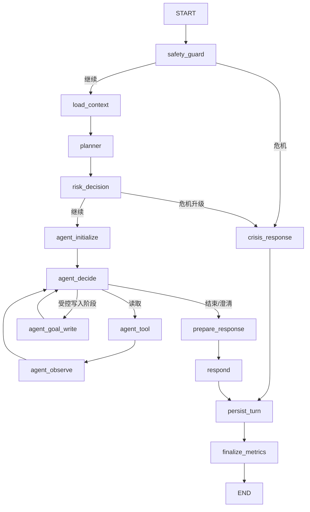

# 当前系统架构

本页描述当前代码。2026-10-20冻结清单、权重和清理范围见[冻结说明](freeze-20261020.md)。历史训练和验收记录以各自日期为准。

2026-10-19：[Agentic RAG v1](agentic-rag-v1-20261019.md) 已在本地开发版启用，在现有 Agent loop 内增加知识查询规划、证据核对和最多一次补检索。

## 职责分界

| 层 | 负责 | 主要实现 |
| --- | --- | --- |
| 浏览器 | JWT、POST SSE、工具活动、目标与报告交互 | `frontend/app.js`、各 `*-view.js` |
| Spring Boot | 用户/会话归属、风险前置、入场控制、事实源与业务事务 | `AgentGatewayService`、`ConversationMemoryService`、`GoalService` |
| LangGraph Runtime | 请求状态图、有限候选决策、工具 loop、证据预算、回复与指标 | `graph.py`、`planner.py`、`tool_controller.py`、`response.py` |
| 模型 worker | 固定问题和候选的概率判断、校准/拒判 | `routing_service.py`、`qwen_choice_service.py`、`qwen_memory_service.py` |
| 统一工具层 | Schema、参数、结果、超时与本地/MCP 传输 | `capabilities.py`、`mcp_client.py` |

Router为Qwen 4B，工具Executor为ToolACE Qwen 4B（Laya故障回退），基础Memory为Qwen 4B；长期事实、目标门控使用独立4B适配器。原版0.6B分别负责记忆和知识重排，两种任务指令不混用。决策与生成独立；具体契约见[根README](../README.md)。

读取契约按动态工具描述评分，文字动作转交回复生成，不解释为目标完成；尚未做项目概率校准。配置及实测范围见[本地接入记录](public-tool-serving-20261019.md)。新增三个适配器随2026-10-20冻结Release发布，旧基线权重继续保留原Release。

## 状态图

正常请求首先加载本会话上下文，Router 输出类型、路线、风险及支持需要，应用策略映射工具权限，并保障明确读取与必需支持资源。Executor 只选择仍可执行的授权工具、finish 或 clarify。执行与观察是独立图节点，结果返回下一步决策。

只读循环默认每轮最多8次，通过 `AGENT_LOOP_MAX_TOOL_CALLS` 配置，硬上限16次；已有结果够用时提前结束。读阶段默认期限60秒（`AGENT_LOOP_TIMEOUT_SECONDS`）；同工具/同参数去重。空结果允许一次受限结构化查询修正，最多等待8秒，不能改变身份、业务ID、写入参数或显式状态范围。写入与最终生成有各自超时，不包含在读阶段期限内。

开发白名单另外支持通用 `search_web` 与专门的 `search_role_voice`，同样经过决策、执行、观察循环并占用读取预算。明确联网请求先由生成模型识别主题；实验角色检索只发送角色名与对话/语气主题。两个新工具属于策略授权的必需读取，尚未加入已训练Executor的有限标签契约。详见 [角色与搜索预览](role-studio-preview-20261017.md)。

危机规则在网关和 Runtime 前置执行，模型不能降级；可信风险判断可升级。危机路径使用固定支持回复，跳过自由生成和目标写入。

## 目标写入与消息保存

创建目标需当前用户明确命令；同步进度需真实行动表述。Executor 的目标判断只能在应用提供的候选中选择。Spring 再核对原话、所有权、动作、完成量、乐观版本和重复请求。

顺序是 **记录原始命令 → 受控目标操作 → 基于实际结果回复 → 保存完整消息与记忆任务**：

1. `begin_turn` 在 MySQL 创建用户 + requestId 唯一的原始 receipt，状态 ACCEPTED。此时不生成占位聊天或记忆任务。
2. 创建/同步读取该原始凭据。一次请求最多创建一个目标，模型不能注入新用户或任意行动 ID。
3. 回复看到实际创建目标/进度回执，不会提前宣称成功。目标卡片可以早于文字回复出现。
4. `persist_turn` 同事务保存用户/助手消息并更新同一 receipt 为 PENDING，保留目标元数据，供后台记忆消费。
5. 已完整保存的请求重放返回原回复，不重复目标、消息或记忆任务；同 requestId 的冲突原话返回 409。

目标已写入、最终消息保存失败时 receipt 仍在，但没有完整中断恢复；单个步骤失败也不构成跨工具事务。checkpoint 不替代业务幂等。

## 记忆与知识

| 数据 | 事实源 | 检索/派生 | 限制 |
| --- | --- | --- | --- |
| 个人对话 | MySQL 用户/助手消息及 receipt | SQLite WAL 原始观察、BM25、近期重排、Memory 筛选 | 按账号隔离，索引异步 |
| 公共心理知识 | MySQL 原文、公开语料快照 | Chroma 768D + 中文 BM25 | 索引可重建，SQL/Chroma 非强事务 |
| 目标与反馈 | MySQL | 有限行动候选、周回顾 | 版本锁、用户可调整/撤销 |
| 缓存/checkpoint | 非业务事实源 | Redis；checkpoint 故障回退内存 | 无自动断点续跑和并发排序 |

个人记忆普通检索保留 BM25 候选，再由 0.6B 重排近期原话补充语义候选，4B 判断相关性和充分性。查询本人已有事实时有显式读取保障；独立回顾问题在候选截断前移除，避免重复提问挤掉答案来源。近期候选扫描最多 96 条、保留最多 24 条；重排池最多 32 条，相关性判断每批最多 16 条。同一工具可补查近期实际消息，不另建跨会话搜索工具。日期、来源角色及最新表达由应用验证；“没有找到”不能证明用户从未说过。

读取诊断通过`pipeline.readAudit`和仅含元数据的`read_audits`队列积累待复核问题，区分未调用、无接纳证据、覆盖不足与回复上下文缩减，不自动产生失败标签。宽泛回顾允许额外最多2条待核来源，但不提升为确认事实。实际案例、私有导出及保留策略见[读取失败复盘](read-failure-review-20261019.md)。

显式本人事实查询没有模型接受证据、且筛选正常结束时，可向已有的最终回复调用交付最多两条完整用户原话作为 `candidateEvidence`。回复模型核对其属性、主体、时间、否定和关系后才回答；这些候选不标记为模型接受证据，不增加一次模型调用。自动背景读取不走这个兜底；候选超出上下文预算时整条丢弃。记忆默认自然融入回复，时间变化、信息冲突及用户追问来源时才说明依据。详见 [跨会话修复](cross-session-recall-fix-20261015.md)。

后台 outbox 每两秒消费待处理轮次，保留用户/助手来源。分类失败仍保存原始观察，失败任务可以重试。历史消息没有自动全量回填，已 DONE 的 outbox 不能自动重建所有丢失索引，当前应保留索引备份。

本分支还包含独立实验账本：`memory_facts`提取原文片段，`memory_shadow`调用4B控制器核验，`memory_projection`在第二层账号白名单、来源审计和版本检查后写入；`memory_ledger`维护条目、出处、变更及单调版本，支持受限撤销。另设读取白名单，通过`memory_read`回查原话来源，合并活跃事实与未管理原话；已替代/撤销的管理片段不会经原话、近期SQL桥接或重排再次进入检索。当前仅合成账号启用，普通账号仍走上面流程；来源失效或读取期间版本改变返回不可用，近期心情仍由原话读取。实现、失败项和限制见 [生命周期第四阶段](memory-read-v1-20261016.md)。

`search_knowledge` 返回教育性知识与引用，`get_support_resources` 返回已配置求助资源。两者独立；心理知识不能用来诊断用户，报告情绪图表示表达次数而非心理量表评分。

## 可观察性与故障边界

SSE 发送实际状态、tool_activity、token、目标卡片和最终指标。callId 区分每次真实调用，计划不算调用；停止浏览器接收不保证服务器推理取消。

| 故障 | 处理 |
| --- | --- |
| Router 不可用/拒判/契约错误 | 受限规则路线及明确读取保障；心理风险不明提供专业资源 |
| Executor 工具选择不可用 | 既有权限内默认顺序，仍受预算约束 |
| 独立目标模型拒判/失败 | 跳过自动写入，不串用工具模型假装成功 |
| Memory 分类失败 | 原始观察保留；检索控制失败回退本人范围内证据 |
| 工具失败 | 标记 unavailable，不编造结果；必要时受限查询修正 |
| MCP 已发送写请求、响应丢失 | 不自动重放；读请求可以本地回退 |
| 生成已有 token 后中断 | 发错误，不拼接第二份回复 |
| 最终保存失败 | warning + persistenceStatus=failed |
| 普通流式容量耗尽 | 短队列与 503；规则危机绕过普通队列 |

身份来自 Spring JWT，不接受浏览器自报可信用户名。内部服务 token 和各 worker key 独立配置。工具 Schema 限制额外参数；历史、记忆和知识均以不可信数据传入，不能授予权限。checkpoint key 为 username:sessionId:requestId，只作请求隔离与追踪。

## 动态读取工具（2026-10-19 开发接入）

受信任的宿主 MCP 清单经过账号/route/只读授权后进入同一 CAPABILITIES 注册表，现有 ToolACE 4B 用描述和 schema 对可变候选与 TEXT 评分；运行时绑定身份并校验选中工具参数，再调用 MCP、观察和输出实际工具活动。新增普通读取工具不再依赖固定 TOOL_CHOICES；旧 Laya 仅为已知候选兜底。目录支持定期和内部鉴权刷新，当前16候选上限；目标写入仍走独立批准回执和业务校验。[接入方式、实测与限制](dynamic-mcp-search-latency-20261019.md)。

动态读取还支持[结束前的一次语义复核](dynamic-tool-narrative-fix-20261019.md)：对尚未执行的授权动态工具判断是否仍有任务、生成并校验参数，保留4B初选和复核来源，遵守原预算及写入边界。

新增动态工具的长句、跨轮和多任务实测见 [动态工具多类型测试](dynamic-tool-multifamily-smoke-20261019.md)，包含同一工具不同参数不能重复执行的已知限制。

同名动态工具不同参数的执行、去重与观察进度复核见 [多参数循环修复](dynamic-tool-repeat-fix-20261019.md)。

当前记忆的分类候选、受控事实读写、来源语义复核及回退见 [记忆受控启用](memory-types-controlled-rollout-20261019.md)。
