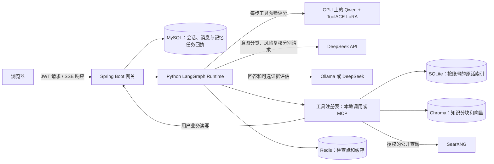
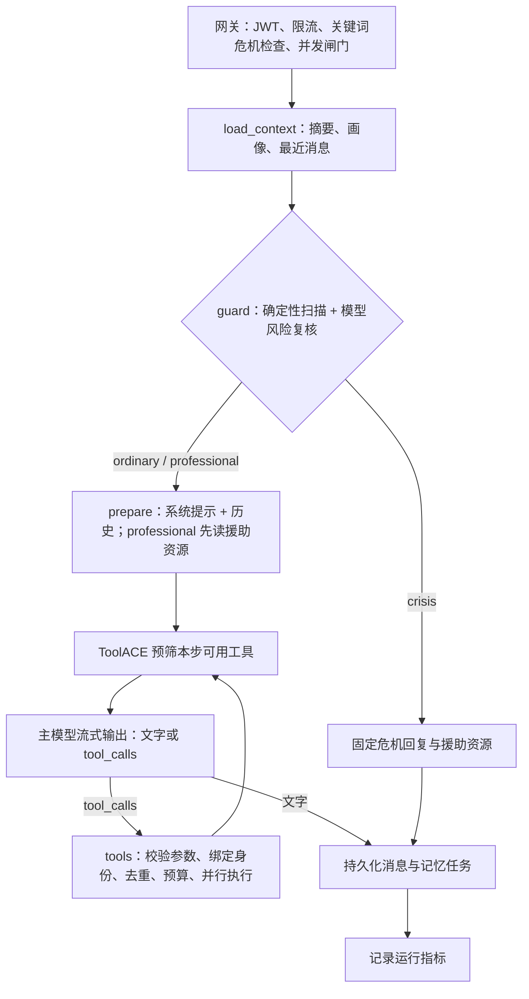

# 总架构 · 一条心理支持对话

**主模型用原生 function calling 自己决定调哪个工具、写什么查询词；宿主负责安全护栏、身份注入、调用预算和超时；ToolACE LoRA 在每一步之前给候选工具打分，只把比“直接回复”分数高的工具交给主模型。**

## 部署和数据

Spring Boot 通过 MyBatis 读写 MySQL 中的会话、消息、记忆任务等业务数据。一次对话结束时，两条消息、会话摘要和待处理的记忆回执在同一个 Spring 事务中提交。重试时按账号和请求 ID 查找已保存的回执，避免重复写入。Flyway 管理表结构。[Mapper 接口](../backend/src/main/java/com/vanilo/psych/agent/repository) · [数据库基线](../backend/src/main/resources/db/migration/V1__application_schema.sql)

后台消费者读取 outbox 中的记忆任务，把对话原话投影到 SQLite。公共知识切块后用 embedding 建索引，查询时再与 BM25 的词项命中合并。Docker 服务与 GPU 评分服务的地址、端口分开配置。[部署配置](../docker-compose.yml) · [启动说明](../HANDOFF.md)

## 一条请求怎么走

`guard` 先用 `SafetyScanner` 做确定性扫描，明确的本人危机表达直接进入危机流程。否则让模型给出风险等级，与扫描结果合并成三档：ordinary、professional、crisis。[安全护栏](../agent-runtime/psych_agent_runtime/guard.py)

主循环是标准的 function calling：模型看到工具定义，自己决定调不调、调哪个、查询词怎么写。工具结果作为 `tool` 消息回填，模型可以据此换个查询词再查，或者直接回答。宿主只做模型做不了也不该做的事：注入账号身份、限制可用工具、去重、限制总调用次数和时间。[图与循环](../agent-runtime/psych_agent_runtime/graph.py) · [工具定义](../agent-runtime/psych_agent_runtime/tools.py)

| 用户意图 | 系统怎么处理 | 能拿什么验收 |
| --- | --- | --- |
| 闲聊、支持资源 | 闲聊可以直接回答；支持资源按授权从业务工具读取。危机分支走专门支持响应。 | 运行轨迹中的路线、工具与回复来源。 |
| 回忆自己的经历 | 模型调用 `recall_memory`，自己写查询词；宿主绑定账号，从本人原话索引查候选并补读近期消息，覆盖后台索引的延迟。 | 原话、会话、时间；换账号后证据应隔离。[Memory](../agent-runtime/psych_agent_runtime/memory.py) |
| 查询心理知识 | 模型调用 `search_knowledge`；Chroma 向量和 BM25 混合召回。结果不相关时模型可改写查询再查。 | 调用参数、知识块和回答引用。[混合检索](../agent-runtime/psych_agent_runtime/rag.py) |
| 查询公开网页 | 显式授权后，SearXNG 先查主引擎，再按需查备用组，只返回摘要和链接。 | 实际返回的 URL 和摘要，以及补查记录。[联网搜索](../agent-runtime/psych_agent_runtime/web_search.py) |

## 面试里的模型边界

ToolACE Executor 现在是工具预筛器。输入是已有对话、已执行的工具调用和结果，以及候选工具的描述与参数结构；它给每个候选和“直接回复”各算一个 yes/no logit 差。比“直接回复”分数高的工具才交给主模型，宿主要求必读的工具始终保留；评分服务不可用时交出全部工具。公开测试集衡量“是否选中示范里的下一步”。[预筛](../agent-runtime/psych_agent_runtime/prefilter.py) · [训练代码](../agent-runtime/training/README.md)
