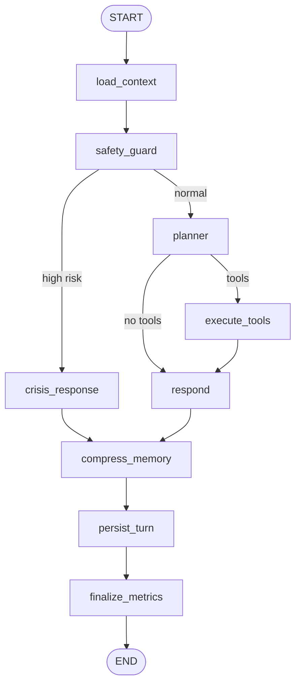
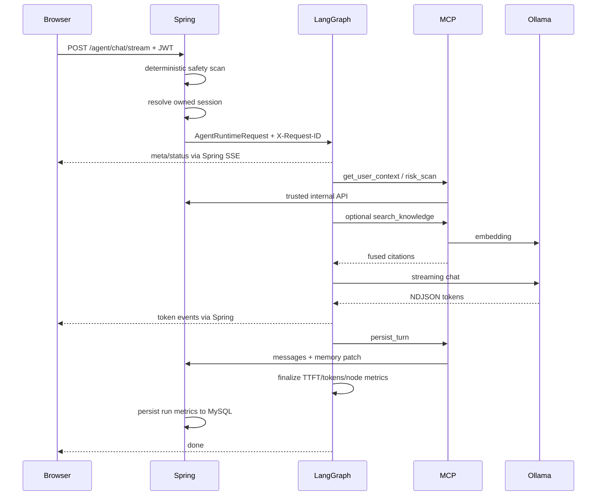

# 系统架构

## 为什么拆成 Java + Python

Spring Boot 保留擅长的部分：JWT、安全规则、用户数据归属、事务、告警、管理端 API。LangGraph Runtime 专注模型工程：图编排、checkpoint、token streaming、上下文预算和压缩。这样不需要把成熟业务层重写成 Python，也不会让模型运行时直接成为公网身份入口。

| 组件 | 主要职责 | 不负责 |
| --- | --- | --- |
| Frontend | JWT 登录、POST SSE、执行态与引用展示 | 保存内部 token、直接调用 MCP |
| Spring Boot | 认证授权、前置安全、会话、报告、告警、Agent 网关 | LangGraph 图状态 |
| Agent Runtime | 图编排、上下文控制、模型流式输出、checkpoint | 公网用户认证 |
| MCP Server | 标准化工具 Schema 与调用 | 用户身份判定 |
| MySQL | 业务事实与长期数据 | 向量相似度 |
| Redis Stack | checkpoint、缓存、限流、热记忆、告警 Stream | 业务事实源 |
| Chroma | Chunk、显式 Embedding、元数据过滤 | 原文管理 |
| Ollama | Chat 与 Embedding 推理 | 安全决策 |

## LangGraph 状态图

图状态包含 `username/session_id/request_id/context/plan/tool_results/citations/reply/compression`。`session_id` 同时作为 checkpoint `thread_id`，因此一次会话的图执行可以被追踪和恢复；业务消息仍以 MySQL 为事实源。

## 一次流式请求

## 信任边界

- 只有 Spring 读取浏览器 JWT。
- Agent Runtime/MCP 的身份字段不接受前端直连；Compose 中两个服务仅 `expose`，不发布主机端口。
- MCP 到 Spring 的 `/internal/agent/**` 使用独立内部 token，并做常量时间比较。
- `username` 和 `sessionId` 最终仍由 Spring 校验归属。
- 角色卡只能改变表达风格，不能覆盖安全规则。
- 模型只能从白名单工具中规划，不能生成任意 URL 或代码执行。

## 安全顺序

安全扫描必须发生在会话读取、RAG、MCP 和 LLM 之前。Spring 是不可绕过的第一道门，LangGraph `safety_guard` 是第二道防线。危机回复为固定模板，不由模型自由生成；正式风险事件先落 MySQL，再进入 Redis Stream 告警流程。

## 降级矩阵

| 故障 | 行为 |
| --- | --- |
| Agent Runtime 连接失败，尚未输出 token | Spring 切换 Java Agent |
| Agent Runtime 输出中断 | 发送 `error`，不拼接第二份回复 |
| MCP 不可用 | Runtime 使用同进程受限 fallback |
| Chroma 不可用 | 管理端 Java RAG 回退到旧索引/MySQL；Agent 返回证据有限 |
| Redis checkpoint 不可用 | LangGraph 启动时回退 InMemorySaver |
| Redis RAG cache 不可用 | 直接检索，不影响正确性 |
| Planner 模型失败 | 确定性意图规则 |
| LLM rerank 失败 | 确定性融合分数 |
| 记忆压缩模型失败 | 有界确定性摘要 |
| 回复已生成但持久化失败 | `warning` 事件，回复仍完成 |

## 可观察性

- Spring：Actuator health/info/metrics。
- Runtime：`/health`、Prometheus `/metrics`、`X-Request-ID`。
- 每轮运行：E2E、TTFT、节点耗时、MCP 耗时、模型调用次数、真实 prompt/completion tokens、吞吐、降级次数。
- 成本：Ollama 本地 `actualCostUsd=0`；可配置 token 单价后同时展示云端等价估算，避免把本地推理伪装成付费调用。
- MySQL：保存用户范围内的运行记录，查询层计算 P50/P95/P99、成功率、降级率、RAG 缓存命中率和每日趋势。
- SSE：前端可见图节点、节点耗时、工具、引用、上下文、记忆和最终指标。
- RAG Trace：保留 query、工具名、引用数量、候选数、缓存状态、检索耗时、分数、来源和匹配原因。
- RAG 离线评测：21 条人工标注查询，绕过在线缓存并计算 Recall@1/3/5、Precision@5、HitRate@5、MRR 与 nDCG@5。
