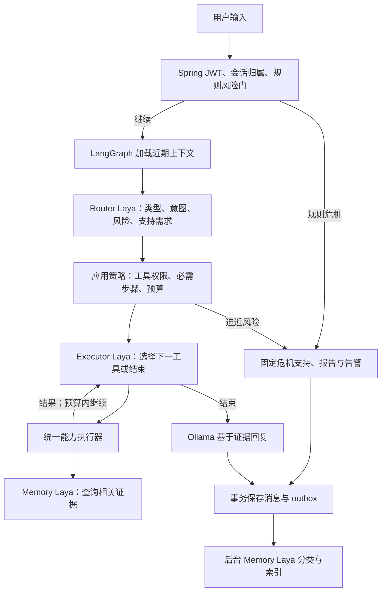

# 系统架构

主链路统一为 Spring 身份/事务网关 + LangGraph 控制器 + 三个独立本地 Laya 决策角色 + Ollama 回复模型。具体模型契约、配置和训练边界见 [本地三 Laya Agent](local-laya-agent.md)。

## 请求与状态

前端使用 JWT 请求 `POST /agent/chat/stream`。Spring 从认证信息解析用户名，并验证会话归属。Runtime 再执行规则风险扫描；命中后跳过 Router、Executor 和自由生成。正常请求每轮调用一次 Router，应用依据可信判断执行风险升级及权限映射。即便判断为聊天，已接受的 urgent 判断仍可升级。

Executor 最多执行两个授权的只读工具；每次读取结果后可以再次决策。专业支持路径中的资源读取由程序强制执行。安全扫描、上下文加载、危机处理和保存是固定节点，不在 Executor 候选集合中。之后构造有界上下文，经 Ollama 流式回复，保存消息并发送最终指标。

checkpoint 标识为 `username:sessionId:requestId`，隔离不同用户及并发轮次；每轮重置临时状态。checkpoint 用于执行追踪，业务历史来自 MySQL。这里没有实现中断后自动续跑或会话并发轮次排序，不能用 checkpoint 替代业务事务。

## 数据边界

| 数据 | 事实源/索引 | 行为 |
| --- | --- | --- |
| 会话消息、目标、行动、反馈、报告 | MySQL | Spring 事务和用户归属校验 |
| 本轮保存凭据、记忆 outbox | MySQL | 用户 + requestId 唯一；相同内容重试幂等，冲突返回 409 |
| 记忆观察及观察先后边 | SQLite WAL | 用户隔离，可从原始记录重建；异步最终一致 |
| 知识 chunk/embedding | Chroma | 配合 BM25 混合检索，原文可重建 |
| checkpoint/缓存/限流/告警 Stream | Redis | 非消息事实源 |

目标域统一容纳目标 → 行动/练习 → 实际反馈。模型只读目标上下文和行动素材；用户在页面明确保存、修改状态、记录反馈或删除。乐观版本锁防止覆盖他人/其他窗口的更新。

旧摘要/画像字段保留兼容已有数据读取，但新链路不再调用同步生成式记忆压缩。消息和 outbox 同事务提交，后台索引失败保留 PENDING，可幂等重放；目前没有失败队列或自动历史回填工具。

## 统一工具与鉴权

`capabilities.py` 统一参数模型、结果校验、超时及重放策略。默认本地执行，同一执行器可经 MCP Streamable HTTP 暴露。Runtime、MCP 和 Spring 内部 API 使用独立服务 token。三个 Laya worker 各用 Bearer token；非回环监听必须配置。

浏览器不能直接指定可信用户名。工具名来自应用白名单，参数来自受信任请求；检索结果和记忆属于不可信数据，不能修改规则、权限或执行命令。规则危机不能被模型降级。角色卡只能影响表达。

## 故障处理

| 故障 | 行为 |
| --- | --- |
| Router 未配置/超时/拒判/契约错误 | 规则路线；心理支持风险不明时提供专业资源 |
| Executor 不可用/拒判 | 该路线的固定默认工具顺序，仍受预算与权限限制 |
| Memory 分类失败 | 保存原始观察，记录未分类状态 |
| Memory 检索控制失败 | 用户范围内 BM25/近期证据回退 |
| 工具不可用 | 标注 unavailable，不编造结果 |
| MCP 已发送写入、响应丢失 | 不自动重放；读取可以同进程回退 |
| Runtime 首 token 前失败 | Spring 固定不可用回复，不追加保存失败提示；旧 Java Agent 已删除 |
| 生成中断且已有 token | 报错，避免拼接第二份回复 |
| 记忆索引失败 | 回复不等待索引，后台保留任务重试 |
| 保存失败 | 发 warning，并将 persistenceStatus 标为 failed |

完整全栈和真实三模型推理尚未验收；自动化覆盖契约、权限、风险升级、幂等保存、真实 H2 事务和用户隔离。新模型接入前需要真实标签、校准和安全评测。
