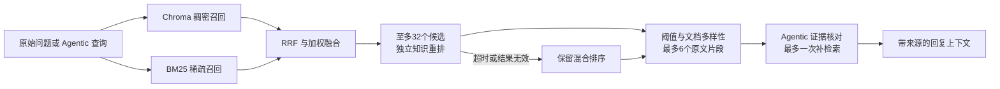

# 目标链路与知识检索修复 · 2026-10-20

本轮补齐目标服务可用性、复合进度表达、进度回读证据和知识候选排序。已加载本地开发环境，没有推送、发布或重新训练模型。验证摘要在 [evaluation/critical-gaps-20261020](../agent-runtime/evaluation/critical-gaps-20261020/)；完整合成场景产物保存在本会话 outputs，不发布账号凭据和原始对话。

## 目标：写入和再次读取都要有证据

检查时 Goal Gate 与 Memory Lifecycle 用户服务已经停止，记录为 SIGTERM；Router、Memory、工具选择服务也没有监听。恢复原权重和合同，核对适配器摘要；缺失的瞬时服务改用数据盘上的持久用户单元，启用失败重启。所有原始权重保持不变，Goal Gate、旧目标决策服务与写入校验继续独立存在。最终运行信息确认三个正式角色、目标门控和生命周期控制器均 ready。恢复服务不等于已定位此前所有停止原因，也不是长时间可用性证明。

真实联调发现：“第一步做完了，只改了示例里的名字就运行成功，但后面太难”被生成模型判为仅 revise 后续步骤，丢失前半句的完成记录。保留该失败版本，调整 `goal_management` 判断说明：复合进度与反馈交给进度流程，先保存进展，再由已有计划器结合完整反馈调整后续步骤；整个目标 complete/pause 仍优先处理。**这是模型语义判断说明的修正，没有新增用户措辞的关键词门槛。** 原4B评分、生成模型写前核对、账号归属、版本、签名、幂等及成功回执校验继续生效。

专用合成账号通过前端代理、Java、Runtime和真实模型完成8轮：

- 创建目标实际保存；完成第一步并附带“后面太难”的反馈后，第一步 done，已有第二步被缩小，保留原步骤身份。
- 未来计划、朋友完成和拒绝同步3种情形均未写入。
- partial 保存，步骤仍未完成；明确结束整个目标后，不再自动生成步骤。

追加检查还发现：部分进度实际已保存，但只读目标快照没有带出打卡记录，模型可能把 planned 误解成没有同步。内部目标读取现在附带同一账号、当前目标集合内最多8条未撤销进度；回复上下文保留 `outcome/note/createdAt`，明确 `saved=true`。partial、blocked、rest 不要求把步骤改成 done。实际回读确认能读取先前保存的字符串变量学习记录，回复也能说明其已保存反馈。只读结果有数量和上下文预算限制，未列出不能证明历史不存在。

## RAG：保留混合召回，增加独立的知识重排

知识库仍是336条资料、454个片段，没有改写旧原文、预期来源或个人记忆库。原漏召回中，夜班、表达感受、支持朋友、就诊准备的相关片段已进入候选，但排序落在第7～31位，未进入最终Top6。另修复了一个确定错误：余弦距离0不能用 `distance or 1.0` 转成最低相似度。

新链路为：

重排使用已经下载、固定摘要的原版 **Qwen3-Reranker-0.6B**，未微调。采用其[官方指令格式](https://huggingface.co/Qwen/Qwen3-Reranker-0.6B)，独立知识指令接受通用科普和实用指导；没有复用 Memory 的“仅用户本人事实有效”指令，也没有改动 Memory 服务。独立进程、端口与凭据，文件、缓存和日志均在 lab 数据盘。

每个候选只返回分数，应用保留原始ID、来源和全文；新分数为 `0.85 × 知识相关分数 + 0.15 × 原混合分数`，随后沿用0.18阈值、每文档最多2片段和Top6。分数没有经过概率校准，不等于回答正确概率。每次请求最多32个候选、每对文本最多2048 tokens、客户端总超时3秒。检查固定模型版本、知识任务身份、完整索引排列和有限数值；失败保留混合结果，不把瞬时失败结果写入查询缓存。重排开关和模型版本进入缓存键，旧缓存不能绕过新链路。

配置：`RAG_RERANK_BASE_URL / API_KEY / REVISION / TIMEOUT_SECONDS`。默认未配置，保留原混合检索；本地开发环境已启用。旧 `RAG_LLM_RERANK_ENABLED` 仅在没有独立重排服务时生效。本轮没有增加一个新的生成模型审查步骤，Agentic RAG原有的查询规划及证据核对预算不变。

## 对照验证

固定预期来源，绕过Redis查询缓存进行串行对照；候选重排服务完成冷启动后测试。额外长句、英文及无关问题在首次对照前固定。均为开发者场景，**不是独立盲测、临床评估或回答准确率**。

| 预期来源诊断 | 原混合Top3 / Top6 | 新重排Top3 / Top6 |
| --- | --- | --- |
| 新增资料14题 | 9 / 9 | 13 / 13 |
| 原有18题 | 17 / 17 | 17 / 17 |
| 额外长句、口语、英文9题 | 5 / 5 | 8 / 8 |
| 无关问题6题：返回空知识结果 | 0 | 6 |

新资料组平均检索耗时从约189ms到332ms，增加约143ms。这里只是当前机器上的串行检索耗时，不含最终回复，不代表并发容量。首次冷启动探测有一次3秒超时并正确回落，后续对照47条查询未发生重排回落。

5个真实语料、真实生成服务的Agentic诊断：夜班、表达感受、支持朋友、就诊准备均一次读取并保留相应机构来源；放松安全仍为两次读取、partial，缺少的具体安全操作没有被伪装成已充分覆盖。读取与审查约2.0～4.9秒，最终全部保留片段均进入本轮上下文。此诊断固定知识工具选择器；另4个完整网关SSE场景通过，覆盖主动支持查询、虚构疗法拒绝、具体问题及明确只想倾诉时不查知识。

Python全套1068通过、1跳过；Java99项、0失败、0错误、1跳过。新增测试覆盖来源ID保留、错误任务/版本拒绝、非法排列与分数、总超时、回落不缓存、缓存隔离，以及目标部分进度回读范围和撤销过滤。

仍保留的缺口：一条CDC原网页此前403，未导入，相关预期来源用例继续失败；儿童创伤支持的特定预期页面仍未命中，尽管返回了其他相关机构资料；一条额外口语沟通问题仍只返回旧FAQ。32候选边界无法修复未进入候选池的证据。生成回答也没有逐句做来源蕴含验证，本轮不能据此宣布每句有据或生产上线就绪。
