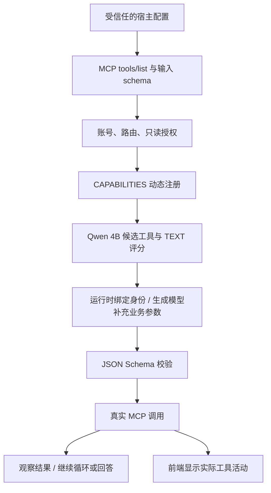

# 动态 MCP 读取工具与搜索延迟优化（2026-10-19）

本轮改动已在本地开发服务启用，未推送正式版、未重新训练权重。仍是有界 Agent Loop；新增工具描述进入现有 ToolACE Qwen 4B 的候选评分，目标写入与记忆判断维持独立模型和原有业务校验。

## 打通了什么

之前模型输入已经支持可变工具候选，但读取准入仍依赖 `TOOL_CHOICES`，参数与 dispatch 固定，前端也会丢弃陌生工具名。现在沿用 `CAPABILITIES` 扩展描述、schema、handler、展示名、身份绑定和路由授权；不再建立另一套执行器。



宿主授予具体工具权限，服务端 `readOnlyHint` 只作契约检查，不独自赋予权限。写入、身份、目标批准凭据不能通过新工具描述进入普通读取循环。模型只判断当前获准候选，不负责授予权限。

- 命名空间隔离远程工具，例如 `docs__lookup_package_version`，防止覆盖系统工具。
- 从 MCP 获取描述、参数 schema，按宿主声明的账号和 route 暴露；缺失或撤下的工具从目录移除。
- 查询类参数可绑定当前消息；账号、session、requestId 由运行时绑定，隐藏于模型可生成参数。其他业务参数由已有生成模型构造，严格校验；缺参或伪造身份进入澄清，不发起调用。
- 动态调用具有独立超时、去重、观察记录与前端展示；新工具不需要增加固定 label 或名称分支。
- 新 4B 不可用时，旧 Laya 兜底只接收它支持的工具。不会给旧模型虚构新工具标签。
- 每轮最多 16 个候选，保留原本必须读取的工具优先级；目录超出上限时记录获准/提供数量。尚未实现大规模工具库的语义召回，需通过 route 限定候选规模。
- 当前仅支持 HTTP Streamable MCP 只读工具。未标为只读的第三方工具不会自动接入；MCP 写工具仍需独立接入审批和业务幂等。

入口：`dynamic_tools.py`、`capabilities.py`、`public_tool_client.py`、`tool_controller.py`、`graph.py`、`mcp_client.py`、前端 `tool-activity.js`。

## 如何接入

`MCP_READ_TOOLS_CONFIG` 指向宿主管理的 JSON 文件。凭据只引用环境变量名，不写入角色卡、模型输入或仓库。

```json
{
  "servers": [{
    "id": "docs",
    "url": "http://127.0.0.1:8099/mcp",
    "token_env": "DOCS_MCP_TOKEN",
    "tools": [{
      "name": "lookup_package_version",
      "label": "查找软件版本",
      "routes": ["chat", "knowledge"],
      "users": ["dedicated-test-account"],
      "bindings": {"query": "message"},
      "timeout_seconds": 10
    }]
  }]
}
```

`bindings` 的来源支持 `message`、`username`、`session_id`、`request_id`；例如远端 `account_id` 参数绑定 `username`。`users` 为空表示宿主向所有账号授予这个工具；不支持 `*`。多个服务各有命名空间。

每分钟按需刷新，或由内部鉴权的 `POST /v1/tools/refresh` 立即重载现有宿主文件；接口不能上传地址、工具定义或授权。`/v1/runtime/info` 显示目录状态和已接入名称。初次验收用的合成工具只授予隔离测试账号，验收后已撤下。随后按用户试用要求，在开发账号开放真实温度换算工具 `units__convert_temperature`，由独立 `units_mcp.py` 服务提供 C/F/K 公式计算和边界校验。容器部署需另外挂载宿主清单、透传配置及其引用的凭据环境变量；本轮没有进行容器部署验收。

## 搜索改动与测量

保持 SearXNG 和本地 Laya 标题/正文两级筛选；角色语气联网搜索继续暂停。

1. 标题评分时并行预取前两页；最多保留三页进入正文候选。
2. 网页读取共用 4 秒窗口，取消超时任务，使用已完成页面；全失败时明确标为搜索摘要，不声称读过正文。
3. 每页最多取三个相关 chunk 和一个跨位置 chunk，整体最多 12 个待评分 chunk，保留完整片段、出处及回复 token 上限。
4. 本地筛选每次最多等待 2.5 秒；失败后冷却 30 秒，同一客户端忙时不继续排队，返回明确标注的词法兜底。
5. 搜索源请求最多等待 6 秒；增加来源检索、标题/抓取、正文评分的阶段耗时。成功搜索缓存从 24 小时缩为 5 分钟，避免“今天”类查询长期复用旧结果。

同机、相同公开查询、强制刷新结果缓存的两次对照：

|查询|原搜索工具耗时|优化后|正文候选 chunk|
|---|---:|---:|---:|
|Python asyncio TaskGroup 官方文档|9.91 秒|6.11 秒|21 → 12|
|MCP tools list_changed 通知|6.22 秒|3.77 秒|17 → 11|

两次均读取三页、保留四个正文片段，并完成了真实本地模型的标题与正文筛选，耗时下降约 38%–39%。这是两个开发样本，不代表 P95、搜索正确率或并发容量；不含前置联网意图判断和最终回复生成。原始数据在本会话 `outputs/dynamic-tools-search-20261019/{before,after}.json`。

代价：更紧的正文候选/时间窗口可能漏掉后部信息，基础 Laya 尚未完成网页任务校准；保留出处、词法兜底和覆盖有限标记。不能将提速称为质量无损。

## 目标回退修复

截图对应的实际开发账号未进入新目标语义门控的灰度范围，仍走旧识别逻辑；另发现独立目标门控服务和转发缺失。恢复原先固定 SHA 的 4B 目标门控、配置当前账号，并将服务改为可持久启动的托管服务。没有切换目标模型或增加短语匹配规则。

运行指标新增独立目标门控状态，区分旧 Executor 目标判断 worker 与新的目标语义 gate，避免前者正常时掩盖后者掉线。权重/契约不匹配或服务不可用仍不写入。

对截图原话的只读重放：学习汇报识别为 `partial`，“所以步骤一做完了”识别为 `done`；仅核对疑问“那你不更新进度吗”识别为读取，不伪造新的完成事实。

隔离测试账号通过实际前端代理 → Java → Runtime → 模型 → Java 数据库验证：创建目标后，普通学习汇报保存部分进展，再报告步骤完成，步骤状态实际变为 `done`，并保存了新的下一步。未自动重放或改写用户原来的目标记录。

## 验证范围

- Runtime 全量：911 passed、1 skipped；最终相关回归 71 passed。
- 前端五组测试通过，包含动态工具事件、展示名转义、系统工具过滤与结果对齐。
- 真实 MCP 模块测试包含发现、账号/路由限制、写工具拒绝、执行、观察、热移除、身份绑定、缺参/伪造参数拒绝。
- 两个新工具名称经真实本地 4B 选择并执行：2/2。服务响应是显式标记的合成夹具，不是实时软件版本数据；不代表严格未见家族泛化准确率。
- 正在运行的应用已验证：热加载目录后，4B 实际选择 `probe__convert_units`，通过 MCP 执行成功，再选择 `finish`；撤销目录后无需重启即移除。刷新接口未鉴权返回 401。另一次真实 HTTP 调用由生成模型补全 `owned_lookup` 的 `topic`，运行时绑定账号后通过 schema 校验并执行成功。

可复用模块探针：`python -m benchmarks.dynamic_registry_probe --out /private/report.json`，需事先加载私有运行环境。源码不包含凭据。

候选评分仍是未经新工具专项校准的相对排序，TEXT 提供不调用工具的选项；框架接通不等于任意新 MCP 工具都能准确选用，复杂参数和未见家族仍需独立评测。

## 可试用的真实动态工具

开发账号现可使用「温度换算」。已通过实际聊天接口验证：显式请求将36°C换成°F，调用新工具并回答96.8°F；不点名工具询问86°F相当于多少°C，也由4B选择该工具并回答30°C。参数由生成模型按新schema构造，工具返回实际计算结果。另有12项单位/边界测试通过；未重新训练、未增加固定工具选择标签。开发服务监听本机18132端口，清单仍由宿主管理。

后续发现并修复[叙述式请求漏调用](dynamic-tool-narrative-fix-20261019.md)：在4B准备结束时最多做一次语义复核，并复用参数生成；与主模型效果分开记录。
