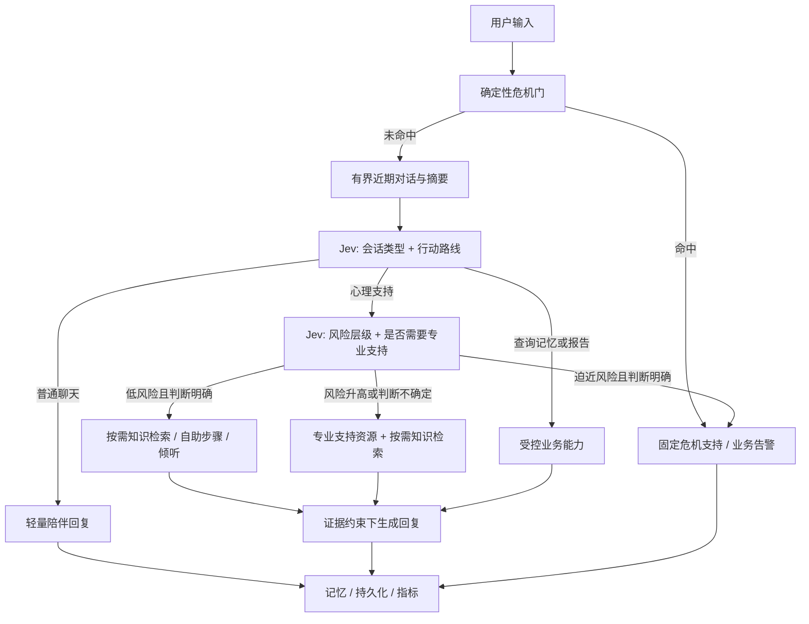

# Jev 分层决策 Agent

项目重点是让专用决策模型掌握受控分支，而不是让回复模型自由生成工具调用。官方 [Jev API](https://docs.typesafe.ai/api) 接收 `state + questions` 并返回 Choice/Noul 等类型化结果。代码根据概率与能力策略执行流程。普通生成模型负责自然语言表达。



## 当前实现

- `jev_decisions.py`：原生 `POST /v1/systemone` 适配器，固定版本 `jev-1.13.0`，支持官方 Choice 与 Noul 响应。第一轮同时判断 `conversation_kind` 与六类 `route`；仅心理支持进入第二轮，判断 `risk_band` 与 `needs_professional_support`。
- `planner.py`：选择 `legacy / jev / laya`；决策模型低概率、超时、协议异常时使用受限回退。当前 Laya 检查点不具备风险头，返回明确的 unknown 状态。
- `graph.py`：危机门 → 会话上下文 → 分层决策 → 各能力流程 → 证据检查 → 回复 → 记忆与持久化。迫近风险可以由 Jev 升级，规则命中的危机不可被模型降低。风险未知或专业支持概率含糊时提供专业支持资源。
- `capabilities.py`：唯一工具注册表、参数模型、超时、重放策略与共享执行器；MCP 与本地回退复用。模型不提供工具参数、URL 或用户身份。
- 前端：展示路线、概率、回退及支持强度，专业资源与危机资源使用不同说明。`plan / decision / evidence` SSE 事件便于检查分支。

这里的风险层级用于选择支持流程，不是临床诊断或经过验证的临床风险评分。普通聊天和心理支持目前使用同一个配置的生成模型，通过不同工具与提示约束区分；尚未实现不同大小的生成模型分流。

## 资源策略

| 决策结果 | 资源 |
| --- | --- |
| 普通聊天 | 不调用风险模型；通常不检索 |
| 心理支持、低风险明确 | 倾听；按用户请求检索知识或生成步骤 |
| 风险升高、专业支持需求或风险未知 | 已配置的非紧急专业支持资源；按需保留知识检索 |
| 规则危机或 Jev 明确迫近风险 | 固定危机支持、紧急资源、现有报告与告警业务 |
| 报告 / 记忆请求 | 保留现有数据归属和只读能力 |

`get_support_resources` 读取服务端配置并过滤紧急资源；没有结果时不生成联系方式。写入型工具发生“已发送但响应丢失”的故障不会再次自动执行。目前没有跨网关与 MCP 的端到端幂等键，也没有人工客服接入队列。

## 启用官方 Jev

```dotenv
ROUTER_PROVIDER=jev
TYPESAFE_API_KEY=<your-key>
JEV_BASE_URL=https://api.typesafe.ai
JEV_MODEL=jev-1.13.0
ROUTER_MIN_PROBABILITY=0.85
ROUTER_TIMEOUT_SECONDS=3
JEV_INPUT_COST_PER_MILLION=0.042
```

只有配置 `jev` 才会调用官方服务；会发送有界的当前文本、最近四条消息和摘要。输入字段排除用户名、画像和工具结果。0.85 是初始工程门槛，尚未用领域数据验证。官方文档也说明中文表现需单独测试。模型版本与返回概率被记录，避免把 confidence 与最高概率混为一谈。

本次没有官方 API key，原生 Jev 的契约与分支使用模拟 HTTP 响应验证，不能声称完成官方服务端到端实测。独立开源 Laya 已完成真实 CUDA 微调与 HTTP 推理测试，但这不是官方 Jev 权重，也没有训练风险头。

Jev 的输入 token 用返回 usage 单独计数，输出免费；与本地 Ollama 混用时成本模式为 hybrid。成本按配置单价估算，并非供应商账单；单价更新时需同步配置。现有 Java 降级层仍保留。

## 决策训练数据

公开心理对话主要用于回复微调，通常没有本项目的会话类型、行动路线和风险标签。`training/prepare_dialogue_decisions.py` 将 PsyDial 和 CPsyCoun 格式转为待标注决策状态，只包含当前用户输入及此前上下文，不包含未来回复。按整段对话的哈希划分训练、校准、验证与测试；同一段对话的不同轮不会跨集合。

`expected` 与 `riskExpected` 默认留空，`reviewed=false`。必须完成标注与审查后才能进入训练；不能把“咨询师问了问题”直接标成“用户意图含糊”，也不能把所有咨询对话标成低风险。先补足普通聊天、否定请求、上下文切换、记忆/报告、专业资源需求和迫近风险等边界。数据源与版本见 [数据调研](dialogue-datasets.md)。

后续实验应分别比较规则路由、生成模型 Planner、官方 Jev 与本地微调决策模型，报告宏平均 F1、拒绝覆盖率、风险升级召回、端到端延迟、工具调用数与成本。当前的 87.8% 只属于 41 条合成六类路由测试，不能用于宣称分层风险判断的效果。
