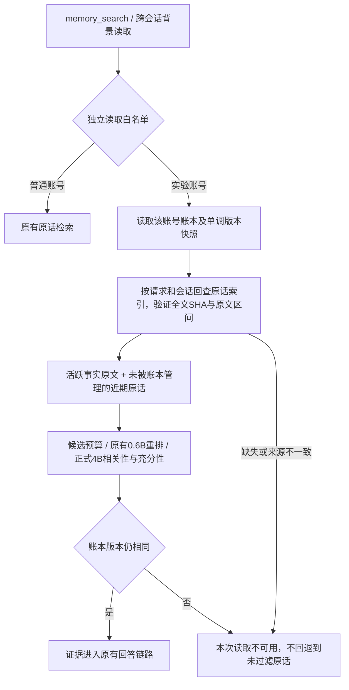

# 生命周期第四阶段：实验读取与等预算对照

此为10月16日快照；当前按账号启用、分类候选及来源复核见[10月19日版本](memory-types-controlled-rollout-20261019.md)。

实验记忆现在可以完成“保存原话 → 控制器判定 → 受控写入 → 跨会话读取 → 依据原话回答”的闭环。仅1个全新合成账号开启读取；普通账号保持冻结检索路径。未重新训练、未替换正式Memory权重，也未迁移原话索引。

## 读取怎样接入

`memory_read.py`负责读取视图，不生成新摘要或新事实。账本和原话索引都按账号查询；原话索引是MySQL outbox的可重建副本，本次并未增加远端权威消息逐条回查接口。每条活跃事实必须与原始用户消息的请求、会话、全文SHA、片段区间和内容相符，返回的`source`继续指向原请求。超过原始候选扫描范围的活跃事实仍可按请求精确回查。

同一消息中，已经被账本管理的片段从原话候选中移除，再加入一次当前活跃事实。已替代、已撤销以及重复补来源的旧片段不会借原话索引重新进入候选；同句未被管理的片段独立保留。例如“我的职业是教师，我今天有点开心”：职业可以进入长期事实，当天心情继续由近期原话读取。

近期SQL桥接使用不同消息ID，按照同一会话及完整原文匹配到已校验来源；遇到匹配来源的截断SQL副本会跳过该副本，保留已回查来源。原有重排的近期扩展也使用同一过滤视图，避免旁路重新带回旧事实。此处文本匹配是保守去重，尚无SQL消息ID与receipt请求ID的直接外键；同会话相同原文的不同出现可能被折叠，不宣称支持精确事件次数统计。

读取期间如果账本发生变更，清空本次已接受证据和待核对候选；下一次调用重新读取。相关性服务故障时，现有词法降级只能使用已过滤视图。来源失效或快照改变则返回`unavailable`，不会偷偷使用未过滤旧原话。版本检查提供读取时的一致快照，不保证生成回复期间永远没有新写入。

## 配置及边界

新增`MEMORY_LIFECYCLE_READ_USERS`，默认空，必须是`sandbox`写入白名单的显式子集，禁止`*`。仍需配置独立账本路径。运行信息增加`memoryLifecycle.read`，检索结果的`retrievalCoverage.lifecycleRead`记录读取策略`memory-current-facts-v1`、账本版本和活跃事实数。写入策略仍为`memory-lifecycle-shadow-v3`，候选权重仍为第二轮v2；没有所谓第三轮模型。

每次最多读取2000条账本来源，超额返回不可用；原话扫描最多2000条，单条候选最多500字符，重排池和相关性预算沿用原配置。来源、审计、变更历史仍未自动归档，不能把这个上限当作完整存储治理。

该视图表达**当前已接受事实与未管理的近期原话**，不是历史时间点查询：被替代的旧偏好不作为默认事实返回。写入队列延迟、模型弃权、转review或故障时，新更正可能尚未形成替代关系，相关原话仍可能并存。测试通过不代表任何表述都会可靠提取或更正。

## 三组对照

同一段8轮自编合成历史，经实际v2生命周期模型和投影器建立账本，不使用标准答案直接写账本。历史包含重复偏好、明确更正、宠物、职业与当天情绪、散步偏好、朋友信息和记忆查询。随后评估13个自编查询。

三组均采用BM25、最多8个候选、候选正文总计最多1600字符、最多交付4条证据；重排器三组都关闭，没有生成模型评分。第三组额外使用现有正式4B相关性/充分性控制器。预算上限一致，实际长度和模型计算量不同。评分只核对预先列出的关键字符串及禁止片段，不计算所有多余证据的精确率。它是证据选择消融，不是向量检索对比，也不是端到端自然回答准确率或独立测试集。

| 方式 | 符合预期 | 夹带旧事实/无关证据的场景 | 模型故障降级 |
| --- | --- | --- | --- |
| 原话检索 | 9/13 | 4 | 0 |
| 当前结构化事实+未管理原话 | 11/13 | 2 | 0 |
| 同一视图+4B控制器 | 12/13 | 0 | 0 |

结构化视图改善了两条音乐更正查询，控制器在两个缺失事实查询中拒绝了无关候选；但“小林喜欢听什么”被现有面向本人事实的来源保护漏掉，第三组该项失败。不能把12/13外推为真实用户准确率，也不能据此宣称JEV优于向量召回。逐条证据和失败项见[公开合成结果](../agent-runtime/evaluation/memory-read-v1-20261016/comparison-results.json)。

## 网关验收与回归

经5175代理→Spring→Runtime→保存/outbox，在全新合成账号的8个独立会话验证：

- 实际完成2条新增、1次重复补来源、1次更正替代和1条职业新增，共5次实验变更；最终3条活跃事实，当天情绪未存为长期事实。
- 跨会话音乐、宠物和当天心情查询均调用`memory_search`，回复包含民谣、芝麻团和开心状态；生日缺失查询也实际调用工具。
- 对同一原话索引/账本再读取，三项检索均报告实验视图，未返回独立旧音乐事实或夹带旧偏好的宠物整句。正式相关性模型仍为`psych-memory-qwen4b-lora-20261012`。
- 首次验收时SSH转发中断，模型不可用且活跃事实为0；虽然生成回复正确，这次只证明原话降级，不计入新链路通过。保留失败记录，恢复连接后使用另一个新账号和空账本重跑上述验收，没有重放失败审计或重复启动训练。
- 完整Python回归587通过（1条已有Starlette/httpx弃用警告），Ruff、Compose配置解析及差异检查通过。新增14项读取测试覆盖旧片段屏蔽、混合句保留、撤销、SQL桥接/重排旁路、账号隔离、来源篡改/缺失、读取期间写入、截断来源和控制器故障。未重新压测或全栈镜像部署。

合成账号凭据、实际网关会话和详细事件只保存在本机私有work/outputs；仓库仅收录合成对照、脱敏网关摘要、模型身份及源码SHA。

## 仍未完成

用户删除向所有派生存储传播、正式索引迁移、自动过期/归档、历史时点查询、通用语义属性与人物关系解析，以及更多独立真实多轮评测仍未完成。普通账号尚未启用实验读写，原话索引仍会增长。当前适合继续小范围验收，不能称为完整生产记忆系统。
