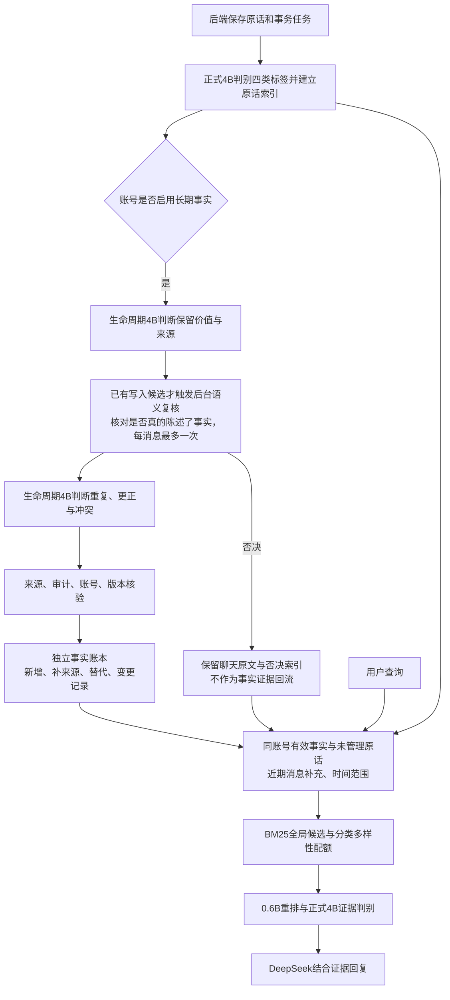

# 分类召回与长期事实受控启用 · 2026-10-19

当前本地开发账号已启用分类引导召回、来源验证的长期事实账本读写。按账号控制，默认不对所有账号开放。未重训或更换正式Router/Executor/Memory权重；没有批量重放用户历史消息，没有推送或部署正式站点。

## 实际链路



原话索引与事实账本都保留来源。源陈述不等于经过客观核实；记录的是用户明确说过的内容。最终回答仍受证据范围约束。

## 分类究竟参与了什么

`memory_types.py`复用正式4B已有的episodic、semantic、preference、procedural判断。只有accepted=yes标签参与分组，多标签保留，失败、弃权、未知标签仍可从全局召回。

当前实现是**候选类别多样性**，没有新增“问题需要哪一类”的查询模型：BM25仍按原查询排名，默认8个候选至少保留原前6个，剩余最多2个位置可补充有词项相关性的未覆盖类别，最后按原全局结果补齐。现有多维查询配额、账号/时间过滤、重排和相关性判别继续使用。近期SQL消息与完整、同会话、完全相同的索引原话合并时可继承分类；截断文本不做标签转移。

分类不授权事实写入。它只是软引导，避免一次分类错误就让信息永远查不到。标签目前来自整条消息，拆分片段会继承源标签；尚未实现通用片段级分类或全历史向量召回。

## 长期事实与来源复核

恢复并固定原生命周期v2检查点，SHA为 `09a35bde69776a6b7da22392062f89aca3f851b543870be4bb31f95b3f4bdc18`，新建独立受管理推理服务，保持其他进程。权重、依赖、缓存、日志位于lab数据盘。初次启动缺少专用包目录，补齐原有PYTHONPATH后通过原服务的权重校验与健康检查；没有重新安装或下载权重。

直接测试发现4B仍会把“我是不是已经养成每天早起的习惯了？”接受为事实。正式Memory的semantic分类也误判了这句话，因此不能拿该标签再次授权写入。

新增`memory_source_review.py`作为**只可否决**的语义复核：

- 仅4B已接受保留价值及来源的候选才触发，复用当前生成模型；同消息最多2个原文候选共用一次请求，6秒超时，在后台运行。
- 核对用户是否陈述了自身事实，保留人物、否定、时间和完整原话；不生成记忆改写，不判断客观真伪，不替代JEV的保留价值和关系判断。
- 返回索引与布尔判断，严格校验数量、索引、类型。决策的模型/策略和原文区间进入已有审计；投影必须再检查复核结果与完整审计，才能执行受控变更。
- API故障、超时、格式错误或不确定时不写事实，原话仍保存。4B拒绝的候选不会因复核而升级成写入。

之后还发现：拒写的疑问句能从旧原话召回，正式相关性模型甚至标记为充分证据。读取视图现在也核验并屏蔽已否决的原文区间，覆盖近期SQL副本；明确回顾提问时保留原话候选。否决索引只存来源、区间、全文哈希等元数据，不复制完整对话，也不因有上限的诊断审计轮转而消失。其来源/并发状态不一致时读取失败关闭，不回退到未经屏蔽原话。读取源预算与现有账本一致有2000条上限，超过上限需维护；尚未实现自动归档或删除传播。

## 验证结果与转正判断

全部是作者编写的开发案例，不是独立测试集、真实用户准确率或临床评估。不是与向量检索的优劣对比。

第一轮使用同一正式4B对原话、分类原话、事实视图、分类事实视图进行13个查询的证据对照：分别9/13、9/13、12/13、12/13；16条写入输入中发现1条疑问句误写。原始失败报告保留。加来源复核后该组未观察到误写，核心新增、补来源、替代均完成。

可公开复现的14项回归（增加“早起习惯未知”）采用相同历史、8候选、1600候选字符、最多4条证据，并统一关闭重排，结果如下。前两组不使用相关性控制器，后两组使用同一正式4B，因此不能把差异全归因于分类或账本。

| 方案 | 关键证据符合预期 | 包含旧事实或不应交付证据的场景 |
|---|---:|---:|
| 原话＋BM25 | 8/14 | 5 |
| 当前事实视图＋BM25 | 11/14 | 3 |
| 当前事实视图＋4B | 13/14 | 0 |
| 当前事实视图＋分类候选＋4B | 13/14 | 0 |

分类这轮无覆盖退步，但没有观察到独立正确率增益。剩余失败是第三人称偏好“小林喜欢听什么”，本人事实保护仍过于保守。16条消息共触发8次后台来源复核，没有最终回答生成评分。

真实网关验收使用新建合成账号，经过5175前端API→Java持久化/outbox→Runtime后台→真实模型与SQLite，9个写入场景和6个跨会话查询：

- 14项明确通过；1项临时偏好进入review，事实内容和版本与上一轮完全相同，没有发生错误替代。原自动评分把review视为失败，原报告保留。
- 审核接受这一项为**安全待复核**，没有算成成功写入或正确skip预测；核心变更与六个读取均通过，未观察到错误写入，准予当前开发账号受控启用。
- 最终形成3条活跃事实：当前音乐、宠物、职业。重复只补来源，音乐更正没有改动宠物，开心状态可从近期原话找回；早起习惯和生日未知返回0条证据。
- 这9条消息的回执在回复后约1.26–2.52秒完成或进入待复核；这是小样本观察，不是时延保证。

最终Runtime回归991 passed、1 skipped，有1条上游Starlette/httpx弃用警告；新增文件静态检查、Compose配置验证通过。开启后核对所有模型就绪，当前账号读取明确报告controlled事实视图和soft_diversity分类策略。没有把合成测试消息写入真实账号。

## 配置、回退和复现

- `MEMORY_TYPE_RECALL_ENABLED=true`：分类软引导，默认false。
- `MEMORY_LIFECYCLE_SHADOW_USERS / SANDBOX_USERS / READ_USERS`：沿用既有显式白名单。
- `MEMORY_LIFECYCLE_ACTIVE_USERS`：本次受控启用账号，必须属于上述读取范围。
- `MEMORY_LIFECYCLE_EXPECTED_SHA`：固定生命周期适配器；不匹配的服务不可写。
- `MEMORY_SOURCE_REVIEW_ENABLED=true`：启用前述后台语义否决；受控启用要求该项存在。

只对之后的新消息处理，不重新解释或改写全部历史。旧原话继续作为未管理历史检索。回退按字段关闭本轮记忆开关、撤回账号白名单并重载Runtime；不回滚聊天库、不删除事实或审计。原配置与一致性SQLite备份存放在本机私有work目录。

公开合成输入、结果和脱敏验收见[复现目录](../agent-runtime/evaluation/memory-types-lifecycle-20261019/)。私下设置模型密钥及生成服务环境后，在agent-runtime目录执行：

```bash
.venv/bin/python -m benchmarks.memory_read_compare \
  --url http://127.0.0.1:18096 \
  --lifecycle-url http://127.0.0.1:18101 \
  --source-review \
  --expected-sha 09a35bde69776a6b7da22392062f89aca3f851b543870be4bb31f95b3f4bdc18 \
  --fixture evaluation/memory-types-lifecycle-20261019/fixture.json \
  --out /private/path/new-memory-comparison
```

该命令只写独立评测库，拒绝覆盖旧报告；`--source-review`会调用已配置的生成服务。密钥不进入命令参数或输出。
