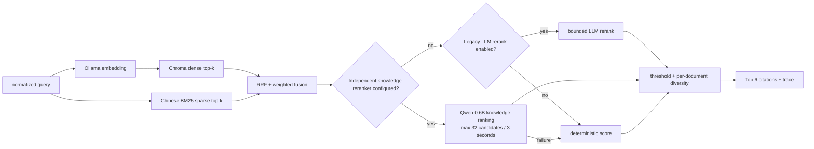

# Hybrid RAG Pipeline

2026-10-20：[关键缺口修复](critical-gaps-20261020.md)已接入独立Qwen0.6B知识重排，保持Memory指令和权重不变。新增资料固定来源诊断从9/14到13/14，旧用例保持17/18；包含长句及无关问题对照，不能作为回答准确率。未配置重排服务时继续使用混合检索。

2026-10-19：本地开发版已接入 [Agentic RAG v1](agentic-rag-v1-20261019.md)，复用本页混合检索底座，增加查询规划、相关性/充分性核对以及最多一次补检索。当前核对使用 DeepSeek Flash，未训练新的本地知识评估模型；验证结果和限制见新文档。

同日完成[知识库扩充与公开数据集核对](knowledge-expansion-20261019.md)：新增17个机构页面、103条中英对照资料，当前336条原始资料、454个向量片段。MedQuAD另有61条历史问答候选，尚未纳入正式索引。新资料预期来源检查9/14命中，原18个用例仍为17/18；自动译文和证据覆盖仍有待审核的问题。

当前实服务检查见 [2026-10-15 检查记录](rag-verification-20261015.md)：知识和向量有效、18道冷检索17道命中预期来源；补充口语触发与当前困扰的自我照顾查询，保留未命中来源和生成扩写的限制。

2026-10-14已接入[有来源的心理知识语料](psych-knowledge-corpus-20261014.md)：33个NIMH页面、202个去重条目，保留中文自动译文与英文原文，当时集合共311个片段。构建和导入CLI见[语料目录说明](../agent-runtime/knowledge/README.md)。对明确主题的通用科普检索优先选择有许可的来源片段；个人倾诉和未覆盖问题沿用原集合。译文仍待全量人工复核。

## 写入链路

1. SQL数据库保存知识原文和业务元数据；开发环境为文件H2，部署配置支持MySQL。
2. Token-aware chunker 按中英文句界切分，默认 `450 tokens + 80 overlap`。
3. 长文 Embedding 按批次调用 Ollama `/api/embed`，避免单次请求无限增长。
4. Chunk 写入 Chroma，元数据包含 `document_id/chunk_index/category/source/revision/estimated_tokens`。
5. 新 revision 先成功 upsert，再清理旧 revision，降低“先删后写”导致索引丢失的风险。
6. Redis 的 `rag:runtime:version` 递增，使旧查询缓存自然失效。

SQL数据库是原文事实源，Chroma 是可重建索引。`POST /knowledge/reindex?source=...` 可按来源重建。

## 查询链路



BM25 tokenizer同时保留中文连续词和二元组，对“考试焦虑”等短中文查询比简单按空格切词可靠。稠密召回解决语义近似，稀疏召回保留精确术语。

融合分数：

```text
score =
  dense_similarity * 0.52
  + normalized_bm25 * 0.33
  + reciprocal_rank_fusion * 0.15
  + optional_category_boost
```

默认参数：

| 参数 | 默认值 |
| --- | ---: |
| Dense top-k | 20 |
| Sparse top-k | 20 |
| Final top-k | 6 |
| Minimum score | 0.18 |
| Sparse corpus bound | 5000 chunks |
| Query cache TTL | 600s |
| Max chunks per document | 2 |

## 为什么显式生成 Embedding

Java 旧实现依赖 Spring AI VectorStore 隐式完成 embedding；新 Runtime 直接调用 Ollama 并把向量传给 Chroma。这样模型版本、批大小、错误位置和写入 revision 都可观察，也不会因为 Chroma 侧默认 embedding function 不一致而产生隐性维度问题。

## 引用与上下文

检索结果不会全部塞进 prompt。ContextBudgetManager 给引用单独分配预算，按排序装入，剩余空间才给历史消息。最终 `ragTrace` 返回：

- requestId、query、tool、status
- citationCount
- 每条引用的 rank、document/chunk id、source、category
- relevanceScore、confidenceLabel、matchReason、excerpt

知识证据不足时，回答提示词要求明确说明证据有限，不能用低相关内容硬凑答案。

## 当前扩展点

数据规模超过单机有界语料后，可把 sparse 路由替换为 OpenSearch/Elasticsearch BM25；LangGraph、MCP Schema、融合与引用层不需要改变。

## 评测口径

`agent-runtime/evaluation/rag_dataset.json` 包含 21 条人工标注的 query → relevant rule，覆盖内置 30 条心理知识。相关文档必须同时满足分类与答案关键片段，不能把在线 `relevanceScore` 当成召回率。评测调用显式绕过 Redis Cache，延迟代表冷检索；在线聊天仍正常使用版本化缓存。

评测输出：

- Recall@1/3/5：相关文档在不同截断位置被召回的比例。
- Precision@5：Top-5 中相关文档比例。
- HitRate@5：至少命中一条相关文档的查询比例。
- MRR：首个相关结果排名倒数的均值。
- nDCG@5：考虑排名位置的归一化折损累计增益。
- 平均/P95 检索延迟、Redis cache hit rate。

管理员从运行指标页触发评测；Runtime 执行真实 Chroma + BM25 检索，Spring 将结果写入 MySQL。
